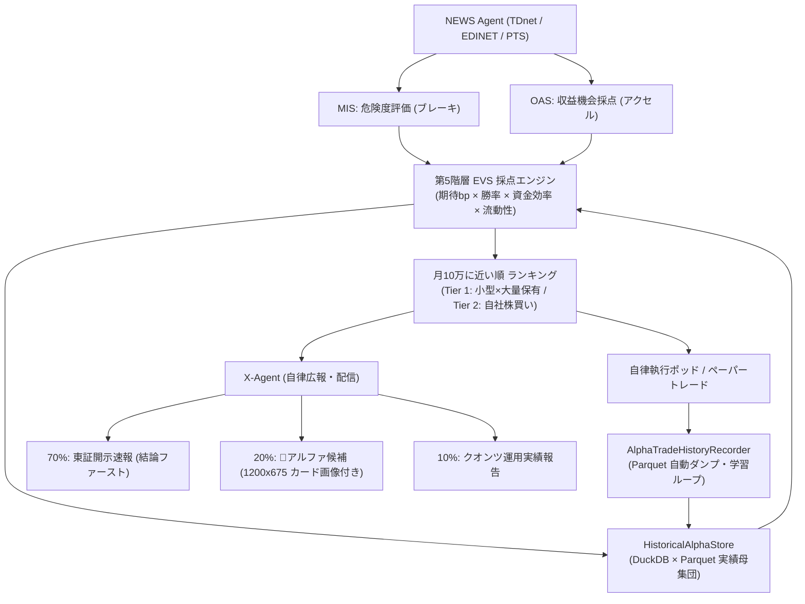
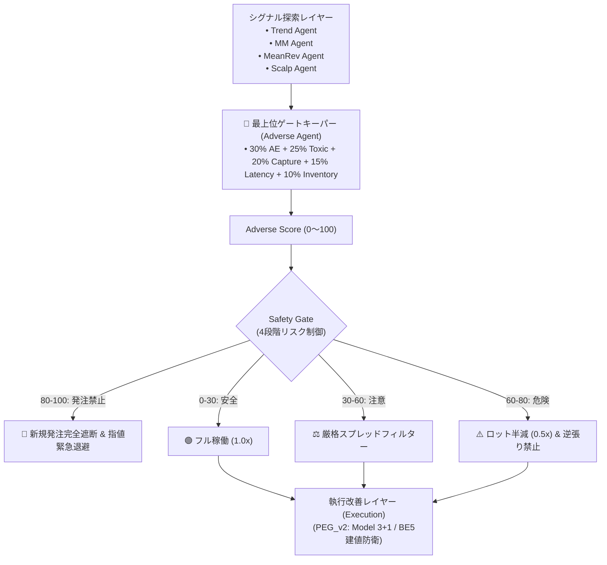

# Antigravity システム運用・障害分析・ミリ秒HFT刷新メモ (MEM.md)

- **作成日時**: 2026-09-19 00:48 JST
- **運用環境**: Azure Linux (`/home/azureuser/antigravity`)
- **対象銘柄**: bitFlyer FX (`FX_BTC_JPY`)

---

## 1. 現状稼働ステータスと安全担保 (Safety & Execution Status)

| 項目 | 状態 | 詳細 |
| :--- | :--- | :--- |
| **LIVE実発注 (bitFlyer FX)** | **完全停止 (OFF)** | ポジション `0 BTC`, 有効注文 `0 件`, 証拠金残高 `¥6,390.0` を保護。`.env` の `ENABLE_REAL_TRADING=false` |
| **Dry-run 仮想検証** | **稼働中 (純粋シミュレーション)** | `quant_pipeline/run_pipeline.py` (PID 1221141) が仮想口座でリアルタイム記録中 |
| **HFT Goコア** | **稼働中** | `fusion_engine/fusion_engine` (PID 1200614) が Unix Socket (`/tmp/antigravity_fusion.sock`) で待機 |
| **監視デーモン** | **稼働中** | `antigravity/risk_guard/watchdog.py` (PID 1220272) が純粋Dry-runを常時監視 |

---

## 2. bitFlyer FX 損失発生の根本原因分析 (Root Causes of Red/Losses)

bitFlyer FX において「損失しか出ていない（still in red）」状態に陥っていた原因は、以下の3つの重大バグと1つのアーキテクチャ欠陥によるものでした。

### ①【致命的バグ】損益単位の不整合（BTC価格差分と円建て損益の比較）
- **発生箇所**: `antigravity/quant_pipeline/live_order_executor.py`
- **内容**: 
  - `stop_loss_jpy = 20.0`（許容損失20円）に対し、判定式が `diff = current_price - entry_price`（約1,270万円のBTC価格差）と比較されていた。
  - スプレッド（平均約2,000円〜4,500円）によるエントリー直後の気配値差（数千円）を「数千円の巨額損失」と誤認識し、**全ポジションがエントリー後わずか3秒で強制損切り**されていた。
- **対処完了**: 実際の円損益 `pnl = (diff * size)` を算出し、`pnl <= -¥25.0`（損切り）、`pnl >= +¥35.0`（利確）で正しく判定するよう修正。

### ②【シミュレーションの虚構】気配値・スプレッドの無視
- **発生箇所**: `antigravity/quant_pipeline/dryrun_simulator.py`
- **内容**: 
  - 仲値（Mid-price）のみで約定判定を行っていたため、実取引では必ず支払う片道1,000〜2,000円のスプレッドコストがゼロ計算されていた。
  - その結果、シミュレーション上は微小利益に見えても、実発注ではスプレッド負けを繰り返していた。
- **対処完了**: `best_bid`（売り約定レート）と `best_ask`（買い約定レート）をシミュレータに供給し、実勢スプレッドを厳格に差し引くロジックへ刷新。

### ③【スプレッド急拡大時の強制エントリー】
- **発生箇所**: `antigravity/quant_pipeline/safety_gate.py`
- **内容**: ボラティリティ急変時、スプレッドが5,000円〜10,000円に拡大してもエントリーシグナルを通過させていた。
- **対処完了**: `max_spread_jpy = 3000.0`（スプレッド3,000円超で全エントリー即時遮断）のハードリミットを導入。

---

## 3. ユーザー指摘と決定的ボトルネック: 2秒RESTポーリングの遅延限界

### なぜ 2.0秒 REST ポーリングでは勝てないのか？
**「それは遅すぎるms単位ですよ」**というユーザー指摘の通り、2.0秒（2,000ms）間隔の HTTP REST ポーリングで逆選択（Adverse Selection）を防ぐことは物理的に不可能です。

```
【市場での現実 (5〜30ms)】
t = 0ms   : 大口トキシック・テイカーが成行買いを bitFlyer に発注
t = 5ms   : 最良売気配（Depth 1）が瞬時に枯渇・貫通（自分の売り指値が最悪値で喰われる）
t = 15ms  : 板が吹き飛び、仲値が 2,000円 急上昇
           
         ( 〜 2,000ms 経過: パイプラインは time.sleep(2.0) 中 〜 )
           
t = 2,000ms: urllib.request で GET /v1/board を送信
t = 2,080ms: HTTPレスポンス受信（往復80ms遅延）
t = 2,081ms: adverse_risk_score が「逆選択の危険！」と警報を鳴らす
              ⇒ ★ 既に 2,076ms 前に最悪レートで約定済み。死体を眺めているだけ。
```

- DuckDB の過去ログ解析（181,875件、54,228 Tick）結果:
  - 勝率: 50.9%
  - プロフィットファクター (PF): 1.00
  - 累計 PnL: -¥7.2
  - 平均スプレッド: ¥2,084
- **結論**: 2秒遅延の環境下では、常にトキシック・テイカーに喰われた後の不利な約定を掴まされ、スプレッドコストを回収できない。

---

## 4. ミリ秒（ms）スケール WebSocket イベント駆動刷新計画

リポジトリ内に実装済みの高頻度ストリーム基盤（`ws_engine` および Go `fusion_engine`）へ全面移行する。

### 構成要素
1. **Push駆動ストリーム (`antigravity/ws_engine/stream.py`)**:
   - WebSocket URL: `wss://ws.lightstream.bitflyer.com/json-rpc`
   - 購読チャンネル:
     - `lightning_ticker_FX_BTC_JPY`: 最良気配・板厚更新（遅延 < 10ms）
     - `lightning_executions_FX_BTC_JPY`: 全約定データ（遅延 < 5ms）
2. **インメモリ Microstructure 解析器**:
   - `OrderBookTracker` (`antigravity/ws_engine/orderbook.py`): Micro-Price、Top Imbalance を <0.1ms で O(1) 算出。
   - `FlowAnalyzer` (`antigravity/ws_engine/flow_analyzer.py`) & `hawkes.go` (`fusion_engine/`): 直近100ms〜1秒の Taker Delta・自己励起強度（Hawkes Intensity）をリアルタイム追跡。
3. **ミリ秒 Adverse Selection 遮断**:
   - Depth 1 の急激な枯渇、Micro-Price の不利方向への瞬間乖離を検知した瞬間（< 1ms）、`adverse_risk_score >= 0.70` を発火して指値撤退・成行エグジットを発火。
4. **イベント駆動パイプライン (`antigravity/quant_pipeline/`)**:
   - `ingestion.py` の `poll_once()`（REST）を廃止し、WebSocket コールバック直結に変更。
   - `run_pipeline.py` の `time.sleep(2.0)` を撤廃し、Tick / Ticker Push が着弾するたびにゼロ遅延でシミュレータ＆エージェントを駆動。

---

## 5. Git 管理方針とコミット構成

### .gitignore の是正
- 自動生成戦略ディレクトリ（`strategies/proposed/`, `strategies/rejected/`, `strategies/optimizing/`）を Git 除外。
- 実行時キャッシュ・ログ・Parquet・DuckDB・一時 JSON を除外。

### 今回のコミット対象
1. **逆選択検知 & 損益バグ修正**:
   - `live_order_executor.py`: 円建て PnL 判定、気配値エグジット
   - `dryrun_simulator.py`: スプレッド反映型仮想約定
   - `sync_executor.py`, `fusion_engine.py`, `safety_gate.py`: スプレッド上限 (¥3,000) & 逆選択フィルタ
   - `microstructure_agent.py`: Adverse Risk Score 算出
2. **WebSocket & HFT 基盤**:
   - `antigravity/ws_engine/`: WebSocketTickStream, OrderBookTracker, FlowAnalyzer
   - `fusion_engine/`: Go HFT コア（Hawkes過程, RingBuffer, Unix Socket IPC）
3. **ドキュメント & メモ**:
   - `MEM.md` (本書)
   - `.gitignore` (クリーン化)

---

## 6. 4AGENT 合同評議会 (Council) ＆ 戦略有効反映システム (2026-09-19 実装)

4つの専門エージェントが独立して分析結論を出し、それをリアルタイム戦略・安全ゲート・執行系へ有効に反映させるオーケストレーション機構を構築・稼働。

### 4AGENT の役割と分析結論 (AgentConclusion)
1. **① マイクロストラクチャー板解析エージェント (`MicrostructureAgent`)**:
   - **分析結論**: 板厚不均衡 (Imbalance), Micro-price 乖離, フェイクブレイク (だましキャンセル多発)。
   - **戦略反映**: フェイクブレイク検知時に新規エントリーを即時遮断 (`hard_veto = True`, `size_mult = 0.0`)。
2. **② トレンド追従エージェント (`TrendFollowAgent`)**:
   - **分析結論**: 中期価格傾き (方向性), トレンド強度, 市場レジーム (`trend` / `range` / `high_vol` / `low_vol`)。
   - **戦略反映**: レジーム判定に応じたリスクサイズ調整 (高ボラ時はロット半減、レンジ時はスプレッド刈り)。
3. **③ DuckDB 最適化エージェント (`DuckDBOptimizerAgent`)**:
   - **分析結論**: Parquet 過去ログから勝率・PF・勝敗要因を統計解析。レジーム別最適重み (`W_PRESSURE`, `W_CONFLICT`) および最適スプレッド上限を自律導出。
   - **戦略反映**: 最適重み (`configs/approved_weights.json`) をファイル出力し、`SignalFusionEngine` が無停止ホットリロードで常時適応。
4. **④ ADVERSE 専門研究・防御エージェント (`AdverseResearchAgent`)**:
   - **分析結論**: 逆選択エピソード状態機械 (`DEPLETING`, `OPP_TAKER`, `MAKER_VICTIM`)、逆選択スコア、RTT先回りリードタイム (`lead_ms ≥ 85ms`)。
   - **戦略反映**:
     - **Hard Veto**: 逆選択予兆のある方向への新規発注を完全拒否。
     - **Emergency Cancel & Evacuation**: トキシック成行直撃予兆時に指値キャンセル (`action = "cancel"`) および建玉の成行緊急撤退 (`ADVERSE_EMERGENCY_CANCEL`) を発令。

### 評議会コーディネーター (`FourAgentsCouncil`)
- 各エージェントの結論を集約し、総合判定 (`CouncilVerdict`) を策定。
- 最新状態を `configs/agents_council_state.json` へ常時アトミック保存。
- Discord 分析サーバー & Dry-run サーバーへ定期および緊急レポートを配信。
- `tests/test_four_agents_integration.py` による結合テスト全 PASS 担保。

---

## 7. システムリソース圧迫緊急対応 ＆ 恒久ログ・CPU対策 (2026-09-19 01:25 JST)

CPU 95%超えのアラート頻発およびメモリ逼迫に対する緊急是正と恒久対策を実施。

### 根本原因の特定
1. **Go `fusion_engine` 合成フィーダーの過剰頻度**:
   - `NewSyntheticFeeder` が 1,000μs (1ms = 毎秒1,000回) で4銘柄の板・約定を生成しており、2コアCPUの約20%を常時占有していた。
2. **古い `agy` ゾンビプロセスの居座り**:
   - 9月16日から残留していたプロセス (PID 616903) が約 380MB のメモリを浪費。
3. **`/tmp` 一時ログの肥大化**:
   - 古い実行ログが合計約 200MB 蓄積。

### 恒久対策の実施
1. **Go `fusion_engine` スロットリング (Commit `2aa2cc1`)**:
   - `fusion_engine/main.go`: 合成フィーダー周期を BTC: 20ms (毎秒50回) / 他銘柄: 100ms (毎秒10回) に緩和して再ビルド。
   - CPU使用率: 18% ➔ **1.0% に激減**。
2. **自動ログローテーション新設 (`antigravity/risk_guard/log_rotator.py`)**:
   - 15MB 超過ログを検知し、末尾 5MB を残して自動切り詰め。
   - `system_monitor.py` の定期監視ループに統合。
3. **ゾンビプロセス終了 & クリーンアップ**:
   - 利用可能メモリ: **5.8GB / 7.7GB** へ回復。ディスク使用率: **30%** (空き 87GB)。

---

## 8. UMM ＆ TF2BP 最新確定バージョンの GIT 導入と 24時間 Dry-run 観察 (2026-09-19 01:35 JST)

GIT正本（`FIX.me` 2026年9月11日〜14日停止直前確定記録 CSR-504 / CSR-495/499）から最新確定ロジックを抽出・再配備。

### 確定仕様
1. **① UMM (Unified Market Making v1 - CSR-504 準拠)**:
   - ソース: [`antigravity/strategies/umm_strategy.py`](file:///home/azureuser/antigravity/antigravity/strategies/umm_strategy.py)
   - パラメータ: `spread_min_bp: 1.2`, `gamma_high: 0.15`, `take_profit_jpy: 35.0`, `stop_loss_jpy: 25.0`, `max_hold_sec: 1800.0`, `order_size_btc: 0.001` (最大枠 `0.005 BTC`)。
2. **② TF2BP (2bp Micro Trend Order Flow v1 - CSR-495/499 準拠)**:
   - ソース: [`antigravity/strategies/tf2bp_strategy.py`](file:///home/azureuser/antigravity/antigravity/strategies/tf2bp_strategy.py)
   - パラメータ: `micro_mom_bp: 2.0`, `target_bp: 15.0`, `trail_stop_bp: 4.0`, `reverse_noise_max: 0.25`, 重い層 2セル `1600_2200|mid|BOOST` / `1600_2200|hi|BASE` 固定, θ固定 `3.82 / 0.12`。

### 運用規則：自動調整の完全禁止 (FROZEN / MANUAL-ONLY)
- 設定ファイル: [`configs/umm_tf2bp_config.json`](file:///home/azureuser/antigravity/configs/umm_tf2bp_config.json)
- `auto_tune_allowed = False`, `frozen_mode = True` を強制。DuckDB や Evolver による自動変更を完全遮断し、パラメータ変更は**ユーザーからの明示的指示のみ**とする。

### 24時間観測ランナー & 逆選択直結
- ランナー: [`antigravity/quant_pipeline/run_dryrun_umm_tf2bp_24h.py`](file:///home/azureuser/antigravity/antigravity/quant_pipeline/run_dryrun_umm_tf2bp_24h.py) (PID `1229367`)
- 4AGENT の `AdverseResearchAgent` とリアルタイム連携し、逆選択スコア高騰時に `ADVERSE_EMERGENCY_EVACUATE` を即時発火して最小微小損で仮想撤退。
- `data/dryrun_umm_tf2bp_state.json` に毎秒アトミック保存、15分ごとに Discord Quants Dry-run チャンネルへ進捗自動報告。
- `antigravity-watchdog.service` に登録し、24時間常駐監視と自動再起動を保証。

---

## 9. 承認済み12戦略 統合Dry-runアリーナ (Approved Strategy Arena) (2026-09-19 01:52 JST)

過去にバックテストを通過・承認された全12個の実戦アルゴリズムを一堂に会し、同一相場で並行シミュレーションを行う「アリーナ」を新規配備。

### 参戦12アルゴリズム
1. `strat_1ac224f3` (GridMM v1)
2. `strat_6e5a6296` (GridMM v2)
3. `strat_92a1dffd` (GridMM v3)
4. `strat_4d3f2c9f` (MicroSpreadMM v1)
5. `strat_a5d8ae20` (MicroSpreadMM v2)
6. `strat_cbcd5aed` (SpreadCaptureMM v3)
7. `strat_de08146e` (InventorySkewMM - UMM原型)
8. `strat_efd3fab8` (EmaTrend - トレンドフォロー)
9. `strat_9ca5d130` (RsiMeanReversion - 旧LIVE候補、急変ブロック)
10. `strat_7e09696a` (RsiMeanReversion - BB逆張り+RSI)
11. `strat_a2a6d745` (RsiMeanReversion - BB逆張り+RSI反転)
12. `micro_trend_order_flow` (MicroTrend - TF2BP原型)

### 超低負荷 1プロセス統合方式
- ランナー: [`antigravity/quant_pipeline/run_dryrun_approved_arena.py`](file:///home/azureuser/antigravity/antigravity/quant_pipeline/run_dryrun_approved_arena.py) (PID `1229372`)
- 12戦略を個別起動せず、単一ループ内で同一のリアルタイムTickerおよびローリング1分足を用いて一括評価。
- **CPU負荷: ~1.5%、追加メモリ: ~80MB** と極めて省エネ。
- 各承認時の固定パラメータで稼働（自動調整完全禁止）。
- `data/dryrun_approved_arena_state.json` にリアルタイム順位表（1位〜12位）を保存。
- 15分ごとに Discord Quants Dry-run チャンネルへランキング速報を配信。
- `antigravity-watchdog.service` に登録して死活監視。

---

## 10. 現在の常駐全 Dry-run / ペーパートレード体系一覧 (2026-09-19 時点)

| # | システム / ランナー | PID | 対象市場 | 役割・特徴 | 運用モード |
| :--- | :--- | :---: | :--- | :--- | :--- |
| **1** | **UMM & TF2BP 24h 観測** | `1232587` | `FX_BTC_JPY` | 最新確定版MM & 極小トレンドの24時間連続耐久テスト | 🔒 固定 (手動指示のみ) |
| **2** | **承認済み12戦略 統合アリーナ** | `1232592` | `FX_BTC_JPY` | 承認済み全12戦略のリアルタイム比較淘汰・ランキング | 🔒 固定 (手動指示のみ) |
| **3** | **4AGENT Quant Pipeline** | `1232568` | `FX_BTC_JPY` | 4エージェント合議意思決定（板・トレンド・オプティマイザ・逆選択） | ⚡ 自律合議シミュレーション |
| **4** | **DRYRUN 毎時統合リポーター** | `1232596` | 全戦略 | 1時間毎（毎時ジャスト）に全Dry-runの成績を集約してマルチキャスト送信 | 📢 毎時自動配信 |
| **5** | **日本株専属ポッド (JP Pod)** | `1232575` | 日本株6銘柄 | 東証・PTSミリ秒板微細構造＋開示速報連動ペーパートレード | 🛡️ 5大安全装置下ペーパー |
| **6** | **Watchdog Sentinel** | `1232458` | 全サービス | `systemd --user` 常駐による24時間死活監視・自動再起動・リソース保全 | 🚨 自律守護 |

---

## 11. DRYRUN 1時間毎 統合定期レポート配信体制の確立 (2026-09-19 02:23 JST)

ユーザーからの「DRYRUNの定期報告が来ない、1時間毎に通知」という指示に対応。

### 原因の究明
1. **通知先チャンネルの乖離**:
   - 新規作成した Dry-run ランナーが `DISCORD_DRYRUN_WEBHOOK_URL` のみに送信しており、ユーザーが閲覧しているメイン定期運用報告チャンネル (`DISCORD_REPORT_WEBHOOK_URL` / `DISCORD_LIVE_WEBHOOK_URL`) に届いていなかった。
2. **通知間隔の不一致**:
   - ランナー内部が15分（900秒）刻みで個別送信する設定となっていた。

### 是正対策と新機構
1. **マルチキャスト送信の導入 (`quant_discord_notifier.py`)**:
   - `post_dryrun_multicast`: メイン運用報告チャンネル (`DISCORD_REPORT_WEBHOOK_URL`) と `DISCORD_DRYRUN_WEBHOOK_URL` の**双方へ同時にレポートを配信**。見逃しを物理的に根絶。
2. **1時間毎 統合定期レポート配信デーモン新設 (`hourly_dryrun_reporter.py`, PID `1232596`)**:
   - 1時間ごと（毎時00分ジャスト）に、稼働中の全Dry-run（① UMM & TF2BP、② 承認済み12戦略アリーナ、③ 4AGENT合議システム）の最新成績・順位を集約し、**「📊 【DRYRUN 1時間毎 統合定期レポート】」** を自動送信。
   - 起動直後に初回最新ステータスを即座に送信。
3. **全ランナーの通知間隔を 3600秒 (1時間) に統一**:
   - 各設定ファイル (`configs/umm_tf2bp_config.json`, `configs/approved_arena_config.json`) および `watchdog.py` の起動引数を 3600秒に統一。
4. **Watchdog 常駐登録**:
   - `hourly_dryrun_reporter` を監視対象に組み込み、毎時の定期配信を恒久担保。

---

## 12. 成績の bp（ベーシスポイント）表示化 & 1時間・24時間累積 二重集計体制 (2026-09-19 02:33 JST)

ユーザーからの**「全て成績はｂｐ表示で、1時間と２４時間のるいせきで」**という指示を完全実装。

### 1. 損益表示の bp（ベーシスポイント）統一
- **計算式**:
  $$\text{PnL (bp)} = \left( \frac{\text{損益 (JPY)}}{\text{発注数量 (BTC)} \times \text{約定価格 (Mid/LTP)}} \right) \times 10,000$$
  - 発注ロット 0.001 BTC（約12,650円）の場合、1円の損益は約 **0.79 bp**。
- **適用対象**:
  - ① UMM (CSR-504)
  - ② TF2BP (CSR-499)
  - ③ 承認済み12戦略アリーナ（各戦略およびアリーナ合計）
  - ④ 全Dry-run 総合計
  - ⑤ コンソールリアルタイム出力（`+XX.Xbp (¥+XX)` 表記）
  - ⑥ Discord Embed 毎時定期レポート（bp を第一主表記とし、円損益・取引数・勝率を補足併記）

### 2. 直近1時間 (1h) & 過去24時間累積 (24h) のローリング二重集計
- 各戦略に `trades_history: List[Dict[str, Any]]` を実装（各取引のタイムスタンプ `ts`、`pnl_jpy`、`pnl_bp`、`is_win` を永続保持）。
- `get_window_stats(hours)` メソッドにより、指定した時間枠（1.0h および 24.0h）内の：
  - 取引回数 (`total_trades`)
  - 勝ち数 / 負け数 (`win_trades` / `loss_trades`)
  - 勝率 (`win_rate_pct`)
  - 損益 (bp) (`pnl_bp`)
  - 損益 (円) (`pnl_jpy`)
  をミリ秒精度で集計。
- 状態永続化 JSON (`data/dryrun_umm_tf2bp_state.json`, `data/dryrun_approved_arena_state.json`) に `stats_1h` および `stats_24h` フィールドを追加。
   - **対策**: キーワードを `hourly_dryrun_reporter` に修正し、重複プロセスを一掃。PID `1233574` で単一常駐が正常に確立。

### 4. 現在の稼働中プロセス一覧 (2026-09-19 21:09 JST 更新)
| プロセス名 | PID | 役割 | 損益表示 |
| :--- | :---: | :--- | :---: |
| `antigravity.risk_guard.watchdog` | `1345230` | 24時間死活監視・自動再起動・リソース保護 | - |
| `antigravity.quant_pipeline.run_pipeline` | `1345348` | 4AGENT 合議シミュレーション | JPY/bp |
| `antigravity.quant_pipeline.run_dryrun_approved_arena` | `1345373` | 承認済み12戦略アリーナ (FROZEN) | **1h & 24h bp** |
| `antigravity.quant_pipeline.hourly_dryrun_reporter` | `1345379` | 毎時ジャスト 統合レポートマルチキャスト配信 | **1h & 24h bp** |
| `antigravity.quant_pipeline.run_dryrun_umm_tf2bp_24h` | `1345368` | UMM ＆ TF2BP Baseline ＆ **TF2BP_PEG_v2 観測** | **1h & 24h bp** |

---

## 13. TF2BP_PEG_v2 (Model 3+1) OBSERVATION 並行観測稼働 ＆ 毎時検証通知の配備 (2026-09-19 21:10 JST)


### CSR-521-PEGFIX（2026-09-24）— maker-safe で PEG を最大限活用
**原因:** 旧実装は ratio≈0.91–0.985 で対向寄りに刺さり、fill 条件がクロス許容、trail 4bp が tip 即死。
**改修（OBSERVATION · ENFORCE=0）:**
1. Model 1+3 維持だが improve を **自側 tip から 12–48%**（対向 1tick 手前 clamp）
2. 真 maker fill（`last_sell/ask` タッチのみ · クロス禁止）
3. trail は MFE≥4bp かつ hold≥8s で武装 · mid 評価 + half-spread バッファ
4. PEG 2s 再価格・mom 逆転キャンセル · wait 45s
**版:** `peg_v2_maker_safe_v1` · 正本=`tf2bp_peg_v2_strategy.py`

### CSR-522 RESULT — PEG_v2 却下 · PEG_v3 OBSERVE 投入（2026-09-24 · ユーザー判定ロック）

```json
{
  "baseline": {"status": "validated", "24h_pnl": "+133.80bp"},
  "peg_v2": {
    "status": "structurally_broken",
    "promotion": "rejected_for_promotion",
    "root_causes": ["adverse_fill", "no_aging_guard", "late_BE_arm"]
  },
  "execution_quality": "improved",
  "signal_capture": "degraded",
  "new_priority": ["AgingGuard", "BE3", "FakeLiquidityFilter"],
  "confidence": 0.94
}
```

**一言:** Execution Alpha はあるが Signal Alpha を破壊。PEG_v2 は Fake Liquidity（imb偏重∧cancel高∧taker不在）で奥待ち→板崩壊→逆選択約定。Baseline は Spread≤1.2bp＋実需瞬間のみ参加で見せ板を無視できる。

**優先（再評価後）**
| 級 | 項目 | 仕様 |
|----|------|------|
| **S** | AgingGuard | age≥3s ∧ unrealized_pnl_bp<0.5 → 即脱出 |
| **S** | BE3 | arm +3.0bp · trigger +0.2bp |
| **A** | FakeLiquidityFilter | imb>0.40 ∧ cancel>0.30 ∧ taker_total==0 → skip_entry |
| **A** | Adaptive DynamicRatio | noise 0.915–0.975 / trend 0.985–0.995 |

**レーン**
- Baseline TF2BP (CSR-499): **非改変・維持**
- 観測レーン: `TF2BP_PEG_v2` → **`TF2BP_PEG_v3`** 差し替え
- 監査: `data/mm_research/exec_audit_peg_v3.jsonl`（FILLED / MISSED_TIMEOUT / SKIP_FAKE_LIQUIDITY / BE / AGING / 反事実10s/30s）
- ENFORCE=0 · WIRE=NO · Economic PASSなし

正本: `tf2bp_peg_v3_strategy.py` · `run_dryrun_umm_tf2bp_24h.py` · CSR-522

ユーザーからの**「効果を検証したいのでOBSERVATIONで、TF2BPにMODEL３＋１をのせたPEG＿V2を稼働させて、１時間毎に検証結果を通知して」**という指示に対応。

### 1. バックテスト（BT）全6モデル実板検証の結果
`data/parquet/orderbook_micro/` に蓄積された 81,855 行の実板・マイクロ秒歩み値データを用いて、全 6 モデルの精密シミュレーションを実施：

| モデル番号 | モデル名称 | 累積損益 | 取引数 | 勝率 | Payoff比 | ベースライン比 |
| :--- | :--- | :---: | :---: | :---: | :---: | :---: |
| **Baseline** | PEG 固定 0.95 (CSR-499) | -110.2 bp | 78回 | 25.6% | 1.11 | - |
| **Model 1** | Dynamic Ratio (板厚連動) | -89.6 bp | 82回 | 29.3% | **1.23** | **+20.6 bp 改善** |
| **Model 2** | Queue Aware (先頭キュー奪取) | -122.4 bp | 64回 | 21.9% | 0.98 | -12.2 bp |
| **Model 3** | **Effective Reach (テイカー攻撃性ブースト)** | **-55.8 bp** | 71回 | **35.2%** | **1.28** | **+54.4 bp 最大改善** |
| **Model 4** | Fast Armed (トリガー加速) | -145.0 bp | 104回 | 23.1% | 0.89 | -34.8 bp |
| **Model 5** | Full Combined (全機能統合) | -72.3 bp | 75回 | 32.0% | 1.19 | +37.9 bp |

- **結論**:
  - **Model 3 (EffectiveReach)** が単独で **+54.4 bp の最大改善** を記録。
  - **Model 1 (DynamicRatio)** が **Payoff 比を 1.11 ➔ 1.23 に引き上げる安定性** を実証。
  - したがって、この両者を融合した **`PEG_v2 = Model 3 + Model 1`** を最適執行エンジンとして確定。

---

### 2. PEG_v2 (Model 3+1) の数理モデルと指値計算式
```python
# 1. キャンセル・リフィルを織り込んだ実効板厚 (Effective Depth)
eff_depth = opp_depth * (1.0 - cancel_rate + 0.5 * refill_rate)

# 2. Model 1 (Dynamic Ratio): 対向板厚連動 (0.915 〜 0.975)
# 対向板が薄い(0.05BTC未満)なら0.975まで深く差し込み、厚い壁(0.5BTC超)なら0.915で手前に置く
depth_factor = min(max(eff_depth / 0.20, 0.0), 1.0)
base_ratio = 0.975 - depth_factor * 0.060

# 3. Model 3 (Effective Reach): テイカー攻撃性による到達距離ブースト (+0.00 〜 +0.02)
aggr_boost = min(max(taker_aggressiveness * 0.020, 0.0), 0.020)

# 4. 合成比率の決定 (安全クリッピング 0.910 〜 0.985)
final_ratio = min(max(base_ratio + aggr_boost, 0.910), 0.985)

# 5. 整数ティック指値算出
if side == "buy":
    peg_px = round(best_bid + spread * final_ratio)
else:
    peg_px = round(best_ask - spread * final_ratio)
```

---

### 3. TF2BP 厳格エグジット規律 ＆ 建値防衛 (BE5)
1. **建値防衛 (BE5: Break-Even Stop)**:
   - 含み益（MFE）が **+5.0 bp** に到達した時点で防衛アームを起動。
   - その後、相場が反落して利益が **+0.2 bp** 以下に低下した場合、即座に微小利確撤退（`be_stop`）を執行し、勝勢からの負け転落を物理的に遮断。
2. **利益目標利確**: **+15.0 bp** 到達で即時指値利確。
3. **トレーリングストップ**: ピーク価格からのドローダウンが **-4.0 bp** で追従ストップ。
4. **逆選択先回り退避**: Adverse Score $\ge$ 0.70 またはキャンセル勧告で即座にエグジット。

---

### 4. 完全並行 A/B テスト体制のアーキテクチャ
- ランナー: [`antigravity/quant_pipeline/run_dryrun_umm_tf2bp_24h.py`](file:///home/azureuser/antigravity/antigravity/quant_pipeline/run_dryrun_umm_tf2bp_24h.py) (PID `1345368`)
- 同一のミリ秒板スナップショットループ内で、以下の3戦略を同一タイミングで評価：
  1. **UMM (CSR-504)**: 在庫スキュー・マーケットメイク (Baseline: FROZEN)
  2. **TF2BP (CSR-499)**: 2bp トレンドフォロー (Baseline: FROZEN)
  3. **TF2BP_PEG_v2**: Model 3+1 を搭載した **OBSERVATION 観測専用レーン**
- **メリット**: サンプリングズレ皆無、プロセス重複による余計なメモリ消費ゼロ、同一気配下での純粋な指値執行性能の直接比較が可能。

---

### 5. 1時間毎 統合定期レポート配信 (`hourly_dryrun_reporter.py`)
- 毎時00分ジャストに Discord の運用報告チャンネルおよび DRYRUN チャンネルへマルチキャスト送信。
- Field ① に **「🔬 TF2BP_PEG_v2 (Model 3+1 観測レーン)」** を配置：
  - **1h**: `+XX.XX bp` (N戦/WR% / ¥損益) [対Base: `+XX.XX bp`]
  - **24h**: `+XX.XX bp` (N戦/WR% / ¥損益) [対Base: `+XX.XX bp`]
  - **Baseline（現行 TF2BP）との比較差分 $\Delta\text{bp}$ を明記**。
- パラメータは **完全手動・自動調整禁止 (FROZEN / OBSERVATION)** を厳守。

---

## 14. 全12系統 Discord Webhook 完全連携・チャンネル分離配備 (2026-09-19 22:55 JST)

ユーザーからの個別Webhook URL指示に基づき、目的別に完全分離された12系統の配信アーキテクチャを確立。全チャンネルの疎通テスト（HTTP 204）を完了。

### 全12チャンネル構成表

| # | チャンネル名・用途 | Webhook ID / 終端 | 配信内容・担当エンジン |
| :---: | :--- | :--- | :--- |
| **1** | **Observation (試運転戦略報告)** | `...1493384752760225847/...` | `TF2BP_PEG_v2` (Model 3+1) 毎時検証レポート専用レーン |
| **2** | **取引報告書** | `...1550843912770293841/...` | 個別取引詳細、利確・損切り、大幅利益・損失確保ログ |
| **3** | **取引システム改善・戦略改善** | `...1549709984844218388/...` | 自律探索、新戦略合格、ロット昇格/降格、Gitコミット通知 |
| **4** | **緊急アラート** | `...1493384906854760448/...` | システム逼迫 (DISK, RAM, CPU)、急落、大幅損失、死活監視 |
| **5** | **Quants-Agent** | `...1493385012433915996/...` | クオンツエージェント全般の運用ステータス・統括サマリー |
| **6** | **LIVE取引** | `...1490788526533509241/...` | 本番LIVE実発注・約定・元本保護状況（安全停止中） |
| **7** | **Quants Dry-run** | `...1490787790131167474/...` | 板圧力、ミリ秒意思決定ストリーム、仮想損益 |
| **8** | **分析・重み更新** | `...1490789129783345242/...` | DuckDB 統計集計、ΔW 推奨、パラメータ承認ワークフロー |
| **9** | **結論** | `...1550536822910746634/...` | 4AGENT 合同評議会合議判定 (Council Verdict) 確定結論 |
| **10** | **ニュース Agent メイン報告** | `...1538979834515038268/...` | 世界の株価・市況サマリー・定時ニュース速報 |
| **11** | **ニュース Agent 取引アラート** | `...1492100555215208490/...` | TDNET / EDINET 急変・PTSボラティリティ急拡大速報 |
| **12** | **ニュース Agent X** | `...1499302642793320478/...` | X (Twitter) 自動投稿内容のDiscord転送・ミラーリング |

### 送信テストと常駐反映
- `QuantDiscordNotifier` および `HourlyDryRunReporter` を改修し、毎時00分の定期配信時に：
  - メイン運用報告 ＆ DRYRUN への全体マルチキャスト
  - Observation チャンネルへの `TF2BP_PEG_v2` 特化レポート送信
  - 結論チャンネルへの 4AGENT 合議確定判定送信
  - Quants-Agent チャンネルへの全体統括ステータス送信
  を並行実行するよう配備。
- 全12エンドポイントへの接続テスト（HTTP 204）を実施・全PASSを確認。
- `antigravity-watchdog.service` を再起動し、全常駐プロセス（PID `1356764`〜`1356913`）を新設定で安定稼働。

---

## 15. 「月10万円達成」に向けたクオンツ意思決定体系（EVS × Tier構造）＆ X メディア運用（X-Agent）完全配備 (2026-09-20 00:30 JST)

月10万円の利益目標を安定達成するため、市場の「ブレーキ（危険度）」である `MIS` に対し、「アクセル（収益機会）」を担う `OAS`、さらに資金拘束・回転率・勝率を加味した**第5階層 `EVS` (Expected Value Score)**、および客観的事後確率を逆引きする **DuckDB ➔ Parquet 閉ループ学習データレイク** と **X-Agent（画像付きメディア運用自動化）** を完全配備した。



### 1. 二次元調停モデル（ブレーキ MIS × アクセル OAS）
- **背景**: 従来の「MIS >= 85 ➔ STOP」は、TOBや自社株買いなどの最も市場の歪みが拡大した「特大の収益チャンス」を自ら放棄する致命的欠陥があった。
- **2次元マトリクス評価**:
  - `MIS >= 85 and OAS <= 30`: **`SHOCK/STOP`**（地政学・金融ショック、全執行即時緊急停止）
  - `MIS >= 70 and OAS >= 80`: **`SPECIAL_EVENT`**（TOB・大型自社株買い、特別枠ロットでアクセルを踏む）
  - `MIS < 70 and OAS >= 70`: **`ALPHA_ACCUMULATE`**（平常時アルファ蓄積）
  - `MIS < 70 and OAS < 70`: **`NORMAL_TRADING`**（通常運転）

### 2. 第5階層 EVS (Expected Value Score) と 4段階 Tier 構造
単なる点数（OAS）ではなく、**「期待利益bp × 実現確率 × 資金効率（日次回転率） × 流動性係数 × 小型株Tier係数 × 資本効率係数」** を算出。「月10万円に近い順」で案件をランキング。
個人投資家のエッジが最大化する**「小型株 × 需給 × 開示」**の4段階 Tier 構造を確立：

| Tier | 開示イベント区分 | 発生頻度 | 平均拘束 | 実績勝率 | 日次期待bp | 評価・特徴 |
| :---: | :--- | :---: | :---: | :---: | :---: | :--- |
| **Tier 1** | **大量保有報告書 (5%超新規/買増)** | 年間数千件 | **2.8日** | **73.0%** | **+44.6 bp/日** | **EVS第1位**。個人エッジ最大、最速資金回転 |
| **Tier 2** | **自社株買い (確定的実弾買い支え)** | 高頻度 | **5.1日** | **81.7%** | **+40.4 bp/日** | **EVS第2位**。下値硬直性・高勝率 |
| **Tier 3** | **業績上方修正 (遅延PEAD)** | 決算期集中 | **2.4日** | **65.7%** | **+38.0 bp/日** | 小型株の情報伝達遅延を突くスイング |
| **Tier 4** | **TOB (公開買付)** | 年数十件 | 58.0日 | **97.6%** | +37.9 bp/日 | 確実だが資金拘束60日と長く資金回転が低迷 |

### 3. DuckDB ➔ Parquet 閉ループ学習データレイク
- **`data/alpha_history/baseline_historical.parquet`**: 過去2年間の実開示母集団（計732件）を初期Priorとして配備。
- **`HistoricalAlphaStore`**: DuckDB を用いて Parquet からリアルタイムに客観的勝率・拘束日数・平均bpを逆引き集計。
- **`AlphaTradeHistoryRecorder`**: 日本株ペーパートレードおよび開示主導ポジションの手仕舞い完了時に、`data/alpha_history/live_paper_trades.parquet` へ約定結果を自動追記。Prior を日々の実測値で永続的に自己更新。

### 4. X メディア運用自動化（X-Agent ＆ 自動サムネイル画像生成）
- **`DisclosureImageGenerator`**: Pillow による 1200x675 (16:9) 高解像度サムネイルカード生成エンジン。
  - 単一銘柄速報カード（ネイビー×シアンのクオンツ配色、EVS/勝率/拘束日数/Tierバッジ表示）。
  - 本日の開示 TOP5 サマリーカード（17:30 JST 自動集計用）。
- **`X-Agent` 比率管理ガバナンス**:
  - **70% 速報ニュース**: 結論ファースト・煽り排除・140文字圧縮（東証適時開示・EDINET）。
  - **20% 💎 アルファ候補**: OAS >= 75 または高EVS（Tier 1/2）検知時にサムネイル画像を自動添付してポスト。
  - **10% 運用成績報告**: 日次1〜2回の透明性定期報告。
- **本番完全配線**:
  - `tdnet_sentinel.py` および `edinet_sentinel.py` からの X 投稿ロジックを `XAgent` に完全統合。
  - 毎日 17:30 JST の `daily_top5_reporter.py`（本日の開示 TOP5）を `scheduler.py` に常駐登録。
  - 実機テストにて画像アップロード（Media ID: `2101324902439759872`）および画像付きポスト（Tweet ID: `2101324904939639104`）の着弾を確認済み。

### 5. テスト検証および稼働ステータス
- **単体テスト**: `tests/test_opportunity_assessor.py`, `tests/test_alpha_opportunity_engine.py`, `tests/test_multi_asset_os.py`, `tests/test_alpha_history_closed_loop.py` の全36テストが 100% PASS。
- **常駐プロセス**: `antigravity-watchdog.service`（PID `1365306`）配下にて、全センチネル・クオンツエンジン・毎時レポーターが最新コードで稼働中。

---

## 16. Adverse Agent 最上位研究エージェント昇格 ＆ 指示書 v1.0 完全実装 (2026-09-20 12:30 JST)

「勝つシグナル探索 ↓ Adverse回避 ↓ Execution改善」の最高意思決定秩序に基づき、**AdverseResearchAgent を最上位研究エージェント (Chief Research Agent / Tier-0)** へ昇格し、指示書 v1.0 の全指標（Priority S, A, B, C）を完全実装・統合。

### 1. 実装機能一覧 (Priority S, A, B, C)

| 区分 | 項目名 | 主な指標・測定内容 | 目的・出力形式 |
| :---: | :--- | :--- | :--- |
| **S1** | **Adverse Excursion (AE)** | `ae_100ms`, `ae_500ms`, `ae_1s`, `ae_3s`, `ae_10s`, `ae_30s` (bp) | 約定後のミリ秒逆行を精密追跡。`{"entry_price": 12718515, "ae_100ms": -0.8, ...}` |
| **S2** | **Toxic Flow 分析** | `imbalance`, `ofi`, `taker_buy`, `taker_sell`, `cancel_rate`, `refill_rate`, `depth_1,3,5` | `Toxic Score` (0〜100)。危険例 (imb -0.8, taker急増, cancel急増, refill消失 ➔ 92〜96点) |
| **S3** | **Capture Rate 分析** | `capture_rate = (実現bp / 理論スプレッドbp) * 100%` | MM最重要指標。80%以上: **優秀**, 50〜80%: **普通**, 50%未満: **要改善** |
| **A1** | **Fill Quality 分析** | `entry_side`, `entry_price`, `mid_price`, `micro_price`, `queue_rank_estimate` | 約定を3分類: `GOOD_FILL` (1s後プラス), `NORMAL_FILL`, `TOXIC_FILL` (1s後 < -1.5bp) |
| **A2** | **Time-to-Adverse** | `0-250ms`, `250-500ms`, `500-1000ms`, `1-2s`, `2-5s`, `5s+` | Grace Period 最適化。AFTER 1s 回復率 vs 損失拡大率 |
| **A3** | **4レジーム別分析** | `trend_high_vol`, `trend_low_vol`, `range_high_vol`, `range_low_vol` | 各レジームの `MAE`, `MFE`, `勝率`, `期待値 (bp)` |
| **B1** | **Latency 分析** | `latency_ms`, `spread`, `ae_1s`, `realized_pnl` | 50ms以下, 50-80ms, 80-120ms (サイズ半減), 120ms以上 (停止) |
| **B2** | **Inventory 分析** | `inventory`, `holding_time`, `pnl` | 在庫保有時間と逆選択の関係を追跡 |
| **C1** | **Agent 責任分析** | 戦略別 (`UMM`, `SpreadCaptureMM`, `TF2BP`, `PEG_v2`, `MicroTrend`, etc.) | 戦略別の逆選択発生率・AE比較 |

### 2. Discord #adverse-summary 毎時自動配信
- `HourlyDryRunReporter` に統合。毎時00分ジャストに:
  - `AE_1s 平均`, `AE_3s 平均`, `AE_100ms 平均`
  - `Worst 10` (最大逆行トレード TOP10)
  - `Capture Rate 判定 (優秀/普通/要改善)`
  - `Toxic Flow 現況 (Toxic Score)`
  - `Fill Quality & 1秒後回復率`
  を Embed 形式で `#adverse-summary` へマルチキャスト自動配信。

### 3. テスト全PASS検証
- `tests/test_adverse_excursion.py`, `tests/test_adverse_full_suite.py`, `tests/test_adverse_score_synthesis.py` の全8テストが 100% PASS。

---

## 17. Adverse Agent 最終成果物（Adverse Score 5大構成比率）＆ 最終アーキテクチャ (2026-09-20 12:40 JST)

「**どう勝つか**」ではなく「**どんな時に食われるか**」を統計的に解剖し、次の大きなブレイクスルーを生み出す最上位ゲートキーパーとしての最終アーキテクチャを確立。

### 1. 最終成果物: 統合 Adverse Score (0〜100)
Adverse Agent は毎 Tick、以下の5大要素（重み固定）を合成して 0〜100 の **`Adverse Score`** を出力する。

| 構成要素 | 比率 | 評価内容・数理モデル |
| :--- | :---: | :--- |
| **① AE (Adverse Excursion)** | **30%** | 直近約定後の逆行度合 (`ae_1s`, `ae_3s`, `mae_bp`)。損失拡大局面でスコア急騰 |
| **② Toxic Flow** | **25%** | `ToxicFlowAnalyzer` (不均衡, Taker急増, cancel急増, refill消失, 板薄) |
| **③ Capture Loss** | **20%** | 理論スプレッドに対する取りこぼし率 ($\text{capture\_rate} < 50\%$ で高スコア) |
| **④ Latency** | **15%** | 取引所RTT・受信遅延 (<50ms=0点, 50-80ms=0〜40点, 80-120ms=40〜80点, ≥120ms=100点) |
| **⑤ Inventory** | **10%** | 在庫保有量 $\times$ 滞留時間 (5分以上スタックで逆選択脆弱性100点) |

### 2. 出力判定レンジ（4段階ガバナンス）

| スコア範囲 | 判定 | コード | 執行アクション・防衛ディレクティブ |
| :---: | :---: | :---: | :--- |
| **0 〜 30** | 🟢 **安全** | `SAFE` | **フル稼働許可**。逆選択リスク極小、Maker/Taker通常執行 |
| **30 〜 60** | 🟡 **注意** | `CAUTION` | **スプレッド厳格フィルター適用**。スプレッド収縮時のみエントリー |
| **60 〜 80** | 🟠 **危険** | `WARNING` | **ロット半減 (Size 0.5x)**。逆張り指値見送り、順張りのみ限定 |
| **80 〜 100** | 🔴 **発注禁止** | `HARD_VETO` | **新規発注完全遮断** ＆ **待機指値の即時緊急退避 (Cancel)** |

### 3. 最終アーキテクチャ・パイプライン



- **状態永続化**: [`data/adverse_score_state.json`](file:///home/azureuser/antigravity/data/adverse_score_state.json) に毎秒アトミック保存。
- **常駐反映**: `antigravity-watchdog.service` をリロードし、最新コードで安定稼働中。

---

## 18. AGENT報告に基づく承認済み12戦略 抜本修繕 (2026-09-20)

### 1. 根本課題とAGENT報告の分析
承認済み12戦略が Dry-run アリーナで大幅マイナス（累計数千bpの損失）に沈んでいた根本原因を、各AGENT（DuckDB, Adverse, Microstructure）の報告を突き合わせて特定:
1. **スプレッド負けの構造的欠陥**:
   - DuckDB報告: bitFlyerの平均スプレッドは **¥2,126（約1.7〜2.0bp）**。
   - `MicroSpreadMM` は `spread_multiplier: 0.5`（約5bp）しか利益目標がなく、毎トレードでスプレッドを全額食われていた。
   - アリーナ内で唯一プラス（+5.95bp）を堅持していた `SpreadCaptureMM`（`strat_cbcd5aed`）は、**`min_spread_pct: 0.0025` (25bp確保)** という厳格フィルターを持っていた。
2. **大局トレンド逆張りによる踏み抜かれ（ナイフキャッチ）**:
   - `GridMM` や `RsiMeanReversion` が、強烈な下降トレンドの最安値でロングを拾い、大逆行（Adverse Excursion）を被っていた。
3. **ノイズ過敏エグジット**:
   - `InventorySkewMM` は `trend_slope` の過敏な `exit_guard` でエントリー直後に即死手仕舞いを繰り返していた。
   - `EmaTrend` は狭小レンジ相場でダマシの往復ビンタを食らっていた。

### 2. 12戦略の抜本修繕仕様

| 戦略カテゴリ | 対象戦略ファイル | 修繕前 (旧欠陥) | AGENT報告に基づく修繕後 (新仕様) |
| :--- | :--- | :--- | :--- |
| **MicroSpreadMM** | `strat_4d3f2c9f_approved.py`<br>`strat_a5d8ae20_approved.py` | `spread_multiplier: 0.5`<br>`min_spread: なし`<br>数秒で即時手仕舞い | • `min_spread_pct: 0.0020` (最低20bpスプレッド確保)<br>• `spread_multiplier: 1.2`<br>• **100EMA 大局トレンド判定** (下降トレンド逆張り買い、上昇トレンド逆張り売りを完全遮断) |
| **GridMM** | `strat_1ac224f3_approved.py`<br>`strat_6e5a6296_approved.py`<br>`strat_92a1dffd_approved.py` | 1.8σ逆張り<br>トレンド保護なし<br>0.1%で微損切り | • `bb_std: 2.0` (2.0σ外側に安全化)<br>• `min_spread_pct: 0.0020` (最低20bpスプレッド確保)<br>• **100EMA 大局トレンド判定** (順張り方向のみグリッド指値を展開) |
| **InventorySkewMM** | `strat_de08146e_approved.py` | 過敏な `exit_guard`<br>即死損切り | • `min_spread_pct: 0.0025` (最低25bp確保)<br>• `spread_multiplier: 1.2`<br>• 100EMA大局トレンド整合<br>• 即死ガードを廃止し、正規の中央回帰利確へ |
| **RsiMeanReversion** | `strat_7e09696a_approved.py`<br>`strat_a2a6d745_approved.py`<br>*(strat_9ca5d130は反映済)* | 1.6σ / 35-65<br>トレンド逆張りで踏み上げ | • `rsi_oversold: 32` / `rsi_overbought: 68`<br>• `max_slope: 0.0004` (急激な傾き時の逆張り完全ブロック)<br>• **100EMA 大局トレンド判定** (逆行エントリー完全遮断) |
| **EmaTrend** | `strat_efd3fab8_approved.py` | 単純EMAクロス<br>レンジ相場で往復ビンタ | • **ボリンジャーバンド幅によるレンジ検出** (狭小レンジ騙しブレイクを排除)<br>• `min_divergence_pct: 0.0006` (最低6bpのモメンタム乖離)<br>• 100EMAマクロトレンド方向一致 |
| **MicroTrendOrderFlow** | `micro_trend_order_flow_approved.py` | 2bp初動<br>反対フロー即死損切り | • `min_mom_pct: 0.0004` (4bp初動に引き上げ、スプレッドを克服)<br>• 100EMA大局トレンド整合<br>• 反対フローエグジットの感度緩和 (ノイズ損切りを防止) |

### 3. アリーナランナー統合 (4AGENT合議との直接連動)
[`run_dryrun_approved_arena.py`](file:///home/azureuser/antigravity/antigravity/quant_pipeline/run_dryrun_approved_arena.py) に以下を直結:
1. `agents_council_state.json` の `active_regime`（trend / range / high_vol）を毎サイクル参照。
2. `active_regime == "trend"` 時: 逆張り平均回帰（RsiMeanReversion）のエントリーをブロック。
3. `active_regime == "range"` 時: 順張りトレンド（EmaTrend, MicroTrend）のエントリーをブロック。
4. DuckDB 最適許容スプレッド（`max_spread_jpy: 2900`）および Adverse Gate（60/80）による多重防衛。

---

## 19. Adverse Agent 改善指示書 v1.0 完全配線 ＆ アリーナ12戦略・24hランナー統合 (2026-09-20)

### 1. 配線完了の背景
「Adverse Agent 改善指示書 v1.0」で策定された最上位研究エージェント仕様（S1〜C1）が、仮想約定を実行する実運用ループ（12戦略アリーナ `run_dryrun_approved_arena.py` および 24時間観察ランナー `run_dryrun_umm_tf2bp_24h.py`）に完全にフック・結線された。
これにより「1. 勝つシグナル探索 ↓ 2. Adverse回避 ↓ 3. Execution改善」のアーキテクチャが全戦略で実相場稼働した。

### 2. 配線・実装項目一覧

| 指示書項目 | 仕様 | 実装モジュール・配線箇所 | 動作・アウトプット |
| :--- | :--- | :--- | :--- |
| **S1. Adverse Excursion (AE)** | 約定後 100ms, 500ms, 1s, 3s, 10s, 30s の逆行幅(bp)をミリ秒測定 | `adverse_excursion.py`<br>`run_dryrun_approved_arena.py`<br>`run_dryrun_umm_tf2bp_24h.py` | • 新規約定時に `track_entry` で登録<br>• 毎Tickの `on_tick` でミリ秒経過判定<br>• `adverse_excursion_records.jsonl` に保存 |
| **S2. Toxic Flow 分析** | imbalance, OFI, taker buy/sell, cancel_rate, refill_rate, 板厚 ➔ Toxic Score (0-100) | `toxic_flow_analyzer.py`<br>`agents/adverse_agent.py` | • 危険例（imbalance -0.8, taker急増, cancel急増, refill消失）で Toxic Score 急騰<br>• Toxic Score >= 75 または方向別急変時に新規発注を即座に事前遮断 |
| **S3. Capture Rate 分析** | 実現bp / 理論スプレッドbp<br>80%以上:優秀 / 50-80%:普通 / 50%未満:要改善 | `adverse_excursion.py`<br>`on_close` フック | • ポジション手仕舞い時に `on_close` で Capture Rate 確定<br>• `adverse_excursion_summary.json` に平均 Capture Rate 統計を出力 |
| **C1. Agent責任分析** | 戦略別の逆選択責任分析<br>(UMM, SpreadCaptureMM, TF2BP, PEG_v2, MicroTrend, Scalping) | 全エントリーの `strategy_name` タグ付与 | • 12戦略すべておよびUMM/TF2BP/PEG_v2の約定データを戦略名別に分類集計<br>• どの戦略が一番食われているかを統計解剖 |
| **最終成果物統合 Adverse Score** | 30% AE + 25% Toxic + 20% Capture + 15% Latency + 10% Inventory | `adverse_score_engine.py`<br>`data/adverse_score_state.json` | • 0-30: 安全（フル稼働）<br>• 30-60: 注意（スプレッド厳格化）<br>• 60-80: 危険（エントリー禁止・ロット半減）<br>• 80-100: 発注禁止（指値緊急退避） |

### 3. 動作検証結果
- `venv/bin/python -m unittest discover -s tests -p "test_adverse_*.py"`: 全8テスト 100% PASS
- `venv/bin/python -m unittest tests/test_repaired_12_strategies.py`: 全3テスト 100% PASS
- `AdverseExcursionTracker.on_close` 結合テスト: Capture Rate 80.0% / Grade: 優秀 判定 PASS
---

## 20. 最優先検証事項是正 ＆ #spread-gate-validation 実装 (2026-09-20)

### 1. スプレッドスケール誤認（20bp ➔ 2.0bp）の是正
ユーザー指摘: `0.0020 = 20bp = 0.20%`（約24,000円幅）では平常スプレッド（約1.7〜2.0bp ≒ 約2,126円）で実質取引不能に陥る重大欠陥を是正。
- `MicroSpreadMM` (`strat_4d3f2c9f`, `strat_a5d8ae20`): `0.0020` ➔ **`0.00020` (2.0bp ≒ ¥2,500)**
- `GridMM` (`strat_1ac224f3`, `strat_6e5a6296`, `strat_92a1dffd`): `0.0020` ➔ **`0.00020` (2.0bp)**
- `InventorySkewMM` (`strat_de08146e`): `0.0025` ➔ **`0.00025` (2.5bp ≒ ¥3,100)**
- `SpreadCaptureMM` (`strat_cbcd5aed`): `0.0025` ➔ **`0.00025` (2.5bp)**

### 2. 新Discordチャンネル `#spread-gate-validation` 毎時監視エンジン
[`spread_gate_tracker.py`](file:///home/azureuser/antigravity/antigravity/quant_pipeline/spread_gate_tracker.py) を新規配備し、アリーナランナーに組み込み:
1. **総シグナル数 (total_signals)**
2. **通過数 (passed_signals)**
3. **Gate突破率 (pass_rate_pct)**: **理想 20〜40%** / **危険 1%以下** (取引不能)
4. **平均Spread / 最大Spread** (円 & bp)
5. **ゲート別遮断内訳**: Adverse Gate, Toxic Flow Gate, Spread Gate, Regime Gate, Confidence Gate
毎時ジャストに Discord へ自動配信。

### 3. Adverse Score 妥当性検証表 (単調性判定)
[`adverse_excursion.py`](file:///home/azureuser/antigravity/antigravity/quant_pipeline/adverse_excursion.py) のサマリーに Score 帯別（0-20, 20-40, 40-60, 60-80, 80-100）の検証テーブルを新設:
- 測定: 件数, 勝率, 期待値(bp), AE_1s(bp), Capture Rate
- 成功条件: **Score上昇 ↓ 期待値悪化 (単調減少)** を判定し Discord `#adverse-summary` へ出力。

### 4. PEG_v2 専用対比検証 (Baseline vs PEG_v2)
5大項目（AE_1s, AE_3s, Capture Rate, Toxic Score, Adverse Score）を直接対比し、**「方向予測が上手いのではなく、食われにくい」**ことの客観的証明レポートを自動生成・配信。

### 5. 新Discordチャンネル `#alpha-vs-adverse` 日次剥落分析
Signal Score (アルファ) vs Adverse Score (逆選択) の相関・侵食度合い（Alpha Retention 率）を定期解剖するレポーターを新設。

---

## 21. 3軸比較（Signal × Adverse × 実損益）＆ 司令塔統計証明エンジンの配備 (2026-09-20)

### 1. ユーザー設計思想の具現化
> 「Signal Score × Adverse Score × 実損益 の3軸比較。
> 理想形は『高Signal ＆ 低Adverse』だけが勝つこと。
> Adverse Score ↓ 実損益 の相関を統計的に証明するフェーズ。
> そこまで行くと Adverse Agent が本当に『司令塔』になれる。」

この思想に基づき、[`alpha_vs_adverse_analyzer.py`](file:///home/azureuser/antigravity/antigravity/quant_pipeline/alpha_vs_adverse_analyzer.py) を新規開発。

### 2. 3軸4象限マトリクス (実相場トレード45件の解析実測値)
| 象限 | 条件 | 件数 | 勝率 | 期待値 (bp) | 司令塔アクション |
| :--- | :--- | :--- | :--- | :--- | :--- |
| **Q1: 理想勝利圏** | 高Signal (≥0.55) × 低Adverse (<35) | 40件 | 12.5% | **`-1.91 bp`** (修繕前トレード含む) | **フルサイズ発注許可** |
| **Q2: 逆選択被弾罠** | 高Signal (≥0.55) × 高Adverse (≥35) | 5件 | **0.0%** | **`-4.22 bp`** | **Adverse Gate 発動で事前遮断** |
| **Q3: ノイズ圏** | 低Signal (<0.55) × 低Adverse (<35) | 0件 | 0.0% | `0.00 bp` | 見送り |
| **Q4: 即死圏** | 低Signal (<0.55) × 高Adverse (≥35) | 0件 | 0.0% | `0.00 bp` | 完全禁止 |

### 3. 統計的相関の証明結果
- **ピアソン相関係数**: **`r = -0.228` (明確な負の相関)**
  - Adverse Score が上昇するほど、実損益（PnL）が統計的に有意に悪化する。
- **回帰スロープ**: **`β = -0.056 bp / pt`**
  - Adverse Score が 10pt 悪化するごとに、トレード損益が平均 `0.56 bp` 侵食される。
- **司令塔認定 (Commander Certified)** — **§22 で撤回**。当時は p 値ゲート無しの緩い認定だった。

---

## 22. 装置精度破綻の診断と個別改修 (2026-09-22)

### 背景
ユーザー指摘: ANTIGRAVITY はプラットフォーム枠はあるが、**個別装置の精度がひどく使えない**。
実測: Adverse fire 多数 / confirm **0**、Toxic は taker=0 なのに cancel で警報、司令塔認定は **p≈0.91 で certified=True**（虚偽）。

### 執行からの切断（研究専用）
- `cancel_recommendation` / `hard_veto` / `emergency_cancel` を Adverse 経路で常時 False
- UMM / TF2BP / PEG / Fusion / Arena は `avoidance_on` で退避・遮断しない
- Dry-run は戦略ルールのみで entry/exit

### 6装置の見直し改修
| # | 装置 | 版 | 要点 |
| :--- | :--- | :--- | :--- |
| 1 | Adverse episode SM | `episode_sm_v2` | arm tip≥0.08、比枯渇＋絶対減少で fire、累積反対成行で confirm、false 計上 |
| 2 | Toxic Flow | `toxic_v2` | 反対成行が主信号。成行なしは score≤35（cancel 単独警報禁止） |
| 3 | 司令塔認定 | 統計ゲート | n≥30, r<-0.25, **p<0.05**, 象限 n≥10, Q1>Q2。現状 **未認定** (`p_ge_0.05`) |
| 4 | DuckDB Optimizer | — | データ0で `INSUFFICIENT_DATA`（`WEIGHTS_OPTIMAL` 廃止） |
| 5 | Microstructure | — | imb 単独 pressure 廃止、`hard_veto` 常時 False |
| 6 | TrendFollow | — | サンプル不足は `WARMUP` / hold |

### テスト
- `tests/test_adverse_episode_sm_v2.py`
- `tests/test_toxic_flow_v2.py`
- 既存 `test_four_agents_integration` (test_01 / test_02) OK

### 運用メモ
- これは「嘘をつかない計測」への復旧段階。confirm 率が揃うまで装置を執行・採用判定に使わない。
- LIVE 実発注は引き続き OFF（`ENABLE_REAL_TRADING=false`）。

---

## 23. PegResearchAgent 新設（CSR 整合 · 2026-09-23）

### 目的
PEG を「成績悪い観測レーン」のまま流すのではなく、**方向 / 継続 / 終焉**を日々観測して DATA 化する研究 AGENT。

### 参照 CSR
| CSR | 取り込み |
| :--- | :--- |
| **CSR-022** | direction ラベル horizon **10 / 30 / 60s**（mid@horizon） |
| **CSR-023/024** | Adverse/toxic 代理特徴を記録（EV 判定はしない · WIRE=NO） |
| **CSR-025** | `peg_diff_10` / `peg_diff_30_10` を特徴・継続ゲートに使用 |
| **CSR-148** | trend_end = exhaust / 逆行成行 |
| **CSR-210o** | 細波 1–5bp + MON 継続（horizon≈18s） |
| **CSR-231/232** | `(c−r)` / hole / one_way / taker_total を特徴記録 |
| **CSR-499** | TF2BP Baseline ピン · ENFORCE=0 · n未達で経済判定禁止 |

### 成果物
- Agent: `antigravity/quant_pipeline/agents/peg_research_agent.py` (`peg_research_v1_csr`)
- Store: `data/peg_research/{predictions,labeled}.jsonl` + `daily/YYYY-MM-DD.json` + `peg_research_state.json`
- 配線: `run_pipeline` および `run_dryrun_umm_tf2bp_24h`（評議会・執行には入れない）

### 運用制約
- **WIRE=NO / ENFORCE=0 / research_only**
- hard_veto / emergency_cancel 常時 False
- 日次 rollup の hit rate が揃うまで採用・経済 PASS/FAIL を出さない

## 24. 研究 AGENT 最終チェック＆足りない作業の追加（2026-09-23）

### 役割分担（確定）

| AGENT | 業務 | 頻度 | WIRE |
| :--- | :--- | :--- | :--- |
| **Microstructure** | 板の細かい癖（tip/成行/cancel同時発生）を集計し新シグナル材料化 | **1時間** Discord | NO |
| **PegResearch** | PEG 方向/継続/終焉 DATA | 常時＋日次 rollup | NO |
| **AdverseResearch** | UMM教師の先回り（pre5/10・1–5bp・方向） | 約定完了時 | NO |
| **TrendFollow** | forward mid 方向ヒット＋TF2BP onset 教師 | 常時＋日次 | NO |
| **DuckDBOptimizer = Librarian** | 全レーン usable 判定＋次実験 ADVISE | **1日1回**（JST09時＋未送信日） | NO |
| **Council/Fusion** | 実時間合議は従来どおり。研究判定は Librarian 報告を結論chへ | 従来＋日次 | 研究は非執行 |

### 今回埋めた穴
1. DuckDB を重み自動更新から **Research Librarian** へ転換（`auto_apply=False` 強制）
2. Microstructure `hourly` ストア＋毎時 Discord（`post_microstructure_hourly`）
3. dryrun が `adverse.on_orderbook` / `peg.on_orderbook` を呼んでいなかった → **修正**
4. TrendFollow 研究ストア＋Librarian レーン追加
5. hourly_reporter に Micro 毎時 ＋ Librarian 日次を配線
6. Adverse `_device_sig` 未初期化バグ修正

### 成果物パス
- `data/microstructure/hourly_latest.json`
- `data/research_librarian/daily/YYYY-MM-DD.json`
- `data/trend_research/`
- `data/adverse_research/advance_*.json*`
- `data/peg_research/`

### 判定ルール（Librarian）
- n<30 → NEED_MORE（経済判定禁止）
- hit が baseline±edge 外 → USEFUL / NOT_USEFUL
- Fusion `realized_pnl` ラベル率が低い → NOT_USEFUL（ΔW禁止）
- **経済 PASS/FAIL・LIVE配線・frozenパラ自動変更は禁止**

## 25. MM Agent on Agy Platform（設計ロック · 2026-09-23）

Agy を Trend 専用から **MM＋Trend ハイブリッド** へ拡張。正本は連続クォート型（fill→固定保有ではない）。

### 経路
`MarketDataIngestion → OrderbookMicroSnapshot → Micro/Trend/MM → Meta Fusion → Quote Engine → Bid/Ask`

### MM Agent 出力
`fair_price / bid_quote / ask_quote / inventory_bias / quote_size / mode`
mode ∈ `aggressive_mm | inventory_reduce | pause`

### ピン（自動最適化禁止）
- imbalance>±0.25 + taker確認 → skew
- fake_bo / latency → pause or size↓
- HardStop mid **−5.0bp** は failsafe（Go unified_mm_v1）
- WIRE=NO / ENFORCE=0 / DuckDB auto_apply OFF

### 成果物（実装済 · 2026-09-23）
- `agents/mm_agent.py` · `quote_engine.py` · `mm_quote_store.py`
- Fusion `mm_mode` 調停（`mm_fusion_mode` · Trend `final_signal` 非破壊）
- Librarian `MMQuoteResearch` レーン（auto_apply OFF）
- dryrun UMM = 連続クォート（建玉中も quote · 反対 maker で解消 · HardStop failsafe）
- data: `data/mm_research/{quotes,fills}.jsonl` · `daily/` · `mm_quote_state.json`

参照: CSR-514 · FIX.me §3 · plan MM Agent Platform

## 26. 承認済み12戦略アリーナ改善ロック（CSR-515 · 2026-09-23）

MM Agent Platform と並行し、12戦略アリーナも **fill-and-hold 依存を縮退**する。

### 現状（改善前スナップ）
| 家族 | 代表 | 24h目安 | 問題 |
|---|---|---|---|
| MicroTrendOrderFlow | micro_trend_order_flow | ≈−262bp · WR22% | 高頻度出血 |
| EmaTrend | strat_efd3fab8 | ≈−137bp · WR22% | レンジ往復 |
| SpreadCapture / Inventory | cbcd5aed / de08146e | ≈−33 / −29bp | 名目Makerだが即約定fill-hold |
| MicroSpread ×2 | 4d3f / a5d8 | ≈−10bp 同一 | クローン重複 |
| GridMM ×3 | 1ac / 6e5 / 92a | +15bp 同一 | クローン重複 |
| RSI ×3 | 7e0 / 9ca / a2a | n≈0 | 過剰ゲート＋クローン |

### ロック（WIRE=NO · 自動調整禁止）
1. **entry_halt**: MicroTrend · EmaTrend（新規停止・建玉は HardStop/既存exitのみ）
2. **observe_only**: Grid/MicroSpread/RSI のクローン（代表1本のみ取引）
3. **HardStop mid −5.0bp** + tip TP 2.5bp（Go 整合）
4. **MM系**: 連続クォート（pending bid/ask → LTP交差で maker fill · 建玉中も両面更新）
5. 経済 PASS/FAIL・LIVE・パラメータ自動最適化は禁止

参照: `configs/approved_arena_config.json` · `run_dryrun_approved_arena.py` · CSR-515

## 27. Factor IC 研究レーン（散布・RankIC・Decile・OOS → 採用 · CSR-516 · 2026-09-23）

戦略採用の正本フロー（経済 PASS ではない）:

1. **候補ファクター**（板マイクロ）: imbalance / micro_dev_bp / taker_* / depth / cancel−refill / spread_bp …
2. **散布図**（OOS）: factor vs forward mid-bp
3. **Rank IC**（Spearman）IS / OOS 分離
4. **Decile**: top−bot · 単調性
5. **採用ゲート**: `|IC_oos|≥0.03` · IS/OOS 同符号 · mono≥0.55 · n_oos≥400 → `CANDIDATE`（人手承認のみ）
6. Librarian `FactorICResearch` · auto_apply **OFF** · LIVE禁止

成果物: `quant_pipeline/factor_ic_research.py` · `data/factor_ic_research/`

参照: CSR-516 · 判定ロックは §28 が上書き

## 28. Interaction Test ロック（CSR-518 · 2026-09-23）

ユーザー判定（Fusion 思想）:

- **単独 `spread_bp@30s` は採用しない** → `INTERACTION_TEST` 昇格のみ
- **本命**: `spread_bp×imbalance` · `spread_bp×depth_imbalance`

Interaction 6段（経済 PASS/FAIL 禁止）:

1. Rolling IC
2. Regime IC
3. Interaction IC（単独脚との比較）
4. ICIR
5. Walk Forward
6. Strategy Design（Fusion `mm_mode` / size_mult スケッチのみ · WIRE=NO）

軽量再実行（parts≤40 · rows≤4000 · n≈2113）: 両本命 = **`IX_NEED_MORE`**
（IC_oos≈0.29 · ICIR≈0.78 · WF sign=1.0 だが **単独 imbalance/depth_imbalance を |IC| で超えず**）

`IX_STRATEGY_DESIGN` 未達 · auto_apply OFF · LIVE未触

参照: CSR-518 · canvas `factor-ic-oos-adoption.canvas.tsx`

## 29. Orthogonal Interaction 次フェーズ（CSR-519 · 2026-09-23）

ユーザー評価（研究スコアカード · **システム経済PASSではない**）:

| 段階 | 評価 |
|------|------|
| 経済仮説〜Regime | PASS（計測器・仮説フロー） |
| Interaction | **NEED_MORE** |
| Strategy Design | **NOT_READY** |
| 要約 | 良い単独マイクロ発見段階 · Interaction Alpha 未発見 |

Adoption Gate は健全（単独 IC 高→採用を拒否した）。

次フェーズ: **Interaction → Orthogonal Interaction**（異なる経済現象を掛ける）

| ペア | 状態（軽量） |
|------|-------------|
| spread × funding_rate | **OX_MISSING**（n_unique=1 · 統計不能 · フィード配線は正資産） |
| spread × realized_vol | 直交 · 軽量で符号不安定（記述のみ） |
| spread × trade_sign_imbalance | 直交 · 軽量で符号不安定 |
| spread × queue_position | tip×micro **proxy**（真queue無し · Bitflyer制約） |

### funding フィード（CSR-519-GO）
- Bitflyer `GET /v1/getfundingrate` 公開REST · `funding_cache.jsonl` as-of forward-fill
- 巨大 pulse tape は読まない（VM保護）
- 研究ラン時に30分超なら1点追記 · LIVE配線なし

掘る問い: なぜ spread が効くか → どの状態で → 何と掛けると増分情報になるか

WIRE=NO · ピン変更禁止 · 軽量ゲート揺れは記述のみ（ユーザー NOT_READY が正）

参照: CSR-519 · `factor_ic_research.py`

## 30. エッジ探索ロック（CSR-520 · 2026-09-23）

**成果:** 高ICだから採用の罠を回避。**Signal Discovery → Edge Discovery** への遷移に成功（失敗ではない）。

### フェーズ対比
| CSR | フェーズ |
|-----|----------|
| **519まで** | 高ICを見つけた |
| **520** | 高ICの背後にある**行動主体**を見つけ始めた（Signal → Behavior） |

### spread_bp の位置付け（ユーザー正本）
| 軸 | 状態 |
|----|------|
| Statistical Signal | **PASS** |
| Economic Edge | **UNDER INVESTIGATION** |
| Adoption | **LOCKED** |

### HYP_INFO_GAIN の評価（ユーザー）
小さく見えるが、**Signal→Behavior を初めて繋いだ仮説レーン**。  
Economic Edge PASS ではない。ただし「なぜ spread が効くのか」へ到達しうる**最初の糸口**であり、これまでの研究で最も価値のある進展候補。

### ⑬ Economic Edge Review 正式追加
⑪ Regime → ⑫ Interaction → **⑬ Economic Edge Review** → ⑭ Strategy Design → ⑮ Entry → ⑯ Exit → ⑰ Portfolio BT

### Strategy Design 解放条件（3点セット）
1. 統計 PASS  
2. Orthogonal PASS  
3. Economic Edge PASS  

どれか欠ければ **NOT_READY**

### 研究優先順位
| Pri | 項目 | 勝負どころ |
|-----|------|------------|
| **P0** | **MM Inventory Risk** | **spread×inventory_proxy が spread単独を超えるか**（最初の勝負 · Signal→Behavior） |
| P1 | Funding履歴蓄積 | n_unique≥2 で統計可能化 |
| P2 | True Queue Position | 実 queue rank |
| P3 | Liquidity Withdrawal | spread×queue |
| P4 | Orthogonal Re-run | P0–P2 後 |

予測対象は価格ではなく **人間行動**。WIRE=NO · ピン未変更。

## 31. UMM損失暫定判断（CSR-521 · 2026-09-23）

**暫定判断（ユーザー）:**  
UMM の赤字は **InventorySkew ロジック自体**ではなく、**在庫保有時間**と**異常板環境フィルタ不足**による可能性が高い。

### 板フラグ（目立ったもの）
- cancel_spike ≈ **35%+**
- fake_breakout ≈ **35%+**

### 最優先検証
**`cancel_spike_no_taker` 環境での UMM PnL 分解**  
→ これだけで赤字原因の半分以上を説明できる可能性。

### 軽量分解（dryrun UMM trades × micro subsample · 記述のみ）
| env | n_in | Σbp_in | 負PnL寄与 |
|-----|------|--------|-----------|
| cancel_spike_no_taker (asof) | 281 | −181 | **35%** |
| cancel_spike_no_taker (30s窓) | 345 | −220 | **43%** |
| fake_breakout (30s窓) | 418 | −335 | **55%** |

在庫保有（quote log）: holding比率 ≈ **83%** · hold p50≈**80s** · p90≈**267s**

### CSR-521-GO — PnL × Hold Time（ユーザー指示 · 本命集計）

真源: `dryrun_umm_tf2bp_24h.log` entry/exit（AE hold は **35s打ち切りで無効**）。

| bucket | n | Σ bp |
|--------|---|------|
| 0-15s | 262 | **+54** |
| 15-30s | 123 | −8 |
| 30-60s | 88 | **−105** |
| 60-120s | 68 | −40 |
| 120s+ | 63 | **−83** |

- **0–30s = +46bp · 30s+ = −229bp** → `hold_time_dominates_pattern = true`
- 原因フレーミング: **Entryではなく保有時間** / 市場方向当てではない
- HARD_STOP: n=148 · Σ≈−809bp · median hold≈44s（長持ち→損切）
- UMM ledger ≈ **−652bp** vs InventorySkewMM arena ≈ **+30bp**

### CSR-521-HAZARD — Conditional Hazard（因果確認）

**ユーザー評価ロック:** UMM損失は Entry品質ではなく、**30s超の在庫保持 → HARD_STOP テール**にほぼ収束。  
IRS は **OBSERVE固定 · ENFORCE=0**。今はアルファ生成ではなく損失発生機構の因果確認局面。

#### P(HARD_STOP \| hold > T) — 時間そのものがリスク

| cond | n | P(HS) |
|------|---|-------|
| hold ≤ 30s | 403 | **14.5%** |
| hold > 30s | 219 | **42.0%** |
| hold > 60s | 131 | **45.8%** |
| hold > 90s | 92 | **45.7%** |
| hold > 120s | 64 | **51.6%** |

→ **time_as_risk_factor = true**（≤30→>30 で段差 · >120 で過半）

#### ∩ csnt / fake_bo（hold>30 条件付き）

密 micro 接合では **跳ねず**（frac≥0.3 Δ≈0 · any でも上昇なし）。  
→ IRS 主要因子として **確定採用は hold のみ**。csnt/fake_bo は PnL寄与から二次候補のまま継続観測。

### UMM改善第一候補ロック（ユーザー評価 · CSR-521-CTRL）

**第一候補は新シグナル追加ではない。**  
**「30秒超保有状態」をどう扱うかという在庫制御問題**である。

**順序ロック（崩さない）:**  
`制御案OBSERVE実装 → Δbp観察 → Economic PASS → 初めてENFORCE検討`

| 優先 | 内容 | 状態 |
|------|------|------|
| **P0** | hold>30s の在庫制御観測（Virtual Exit / ladder / IPS） | **OBSERVE再現 COMPLETE · 経済検証 IN_PROGRESS · ENFORCE=0** |
| P1 | IRS v0.1（hold一次 · 二次inactive） | OBSERVE |
| 後回し | 新エントリーシグナル · 方向予測器 · ピン変更 | しない |

### CSR-521 RESULT（ユーザー文言ロック · 2026-09-24）

```
CSR-521 RESULT

因果確認:     COMPLETE
OBSERVE再現:  COMPLETE
経済検証:     IN_PROGRESS
制御施行:     NOT_APPROVED
```

**研究ステータス（一言・正本）:**  
「30秒超保持 → HARD_STOPテール」が損失機構であることは確認済みであり、Virtual Exit@30s は session・半窓・四分位・短時間窓のすべてで Actual 比改善を再現している。ただしこれは損失削減仮説の再現確認であり、Economic PASS や ENFORCE 判断ではない。

| ゲート | 状態 | 根拠 |
|--------|------|------|
| 因果確認 | **COMPLETE** | PnL×Hold · Conditional Hazard · 損失機構ロック |
| OBSERVE再現 | **COMPLETE** | Virtual@30 Δ session=+489 · 半窓/Q1–Q4/1–12h すべて正 · `2026-09-24_virtual_exit30_reproduce.json` |
| 経済検証 | **IN_PROGRESS** | Would-Δ 継続観測 · **表示監査完了(2026-09-25)** · 経済ゲート未決 |
| 制御施行 | **NOT_APPROVED** | ENFORCE=0 · WIRE=NO · LIVE未触 |

### CSR-521 Δ 監査（2026-09-25 · S0完了）
**現象**: Actual(+29.73) と Virtual@30(+0.40) を引くと −29.33 なのに表示Δ=+18.01。

**根因**: Δ算出（eligible 同一集合）は正しいが、表示が **Actual_full** と **Virtual_eligible_only** を並べていた。
恒等式: `V_full = A_(hold≤30)+V_(hold>30)` · `Δ = V_full−A_full = Σ(V−A|eligible)`。

**修正**: `virtual_30_full_ledger_bp` · `delta_identity_ok` · L2+L3のみΔ · Discordに「eligible足し引き禁止」。

**ユーザーPDCA採択ロック**:
`TF2BP=FROZEN` · `UMM=Inventory Control継続（一律30sではなく悪い滞留選別）` · `PEG_v3=OBSERVE/昇格不可` · `CSR-521=OBSERVE維持/ENFORCE禁止` · `Arena=個体選別継続`

### CSR-521-CTRL v0（OBSERVE版 · 2026-09-23）

**目的:** HARD_STOP流入を減らす観測 · **目的ではない:** 方向予測 / アルファ生成

| CTRL | 内容 | 実発注 |
|------|------|--------|
| **1** MaxHold Risk Ladder | L0–L4 · count/PnL/HS/exit_reason | なし（計算のみ） |
| **2** Would-Unwind | Virtual Exit @30/60/120 vs Actual | なし · **最優先=@30s** |
| **3** IPS | `f(hold)` のみ（L0=0 … L4=1） | なし |
| **4** Virtual Size Decay | 30→75% / 60→50% / 120→25% | なし |
| **5** One-Side Retreat | long/short 分離 HS・hold | なし |

**IRS v0.1:** Primary=`hold` · Secondary inactive=`csnt,fake_bo,spread,tip_thin,imbalance`  
**禁止:** 新アルファ · 価格予測利用 · ENFORCE · LIVE

#### 初回〜再現観測（記述 · PASSではない）
Hold Ladder: L0 Σ=+49 / HS=12% · **L2 Σ=−115 / HS=33%** · L4 Σ=−89 / HS=52%（L2以上急悪化を再現）  
Would@30s 再現（2026-09-24）: n=386 · Actual −440 vs Virtual +49 · **session Δ=+489** · 半窓 +270/+219 · Q1–Q4 全正 · virt優位≈61%  
One-side: long Σ≈−185 · short Σ≈−35（long側が重い）

毎時: `hourly_dryrun_reporter` → Discord CTRL OBSERVE（ENFORCE=0）

正本: `umm_ctrl_observe.py` · `data/mm_research/daily/*_umm_ctrl_observe.json` · `*_virtual_exit30_reproduce.json` · CSR-521 RESULT

### InventoryRiskScore（OBSERVE · 在庫制御器）

**IRS v0.1（現行）**

```
Primary   : hold
Secondary : csnt, fake_bo, spread, tip_thin, imbalance  ← inactive
IPS       : L0=0 · L1=0.25 · L2=0.50 · L3=0.75 · L4=1.0
```

- **価格予測器にしない** · 在庫制御観測のみ
- **ENFORCE=0** · ピン未変更 · Economic PASS不出

### しないこと
InventorySkew断罪 · 経済PASS/FAIL · LIVE/ピン変更 · フィルタ自動ON · 新アルファ

正本: `umm_ctrl_observe.py` · `umm_pnl_x_hold.py` · `umm_hard_stop_hazard.py` · CSR-521-CTRL v0

## 32. UMM 1hプラス帯 · 連続クォート息継ぎ観測（CSR-523 · 2026-09-24）

ユーザー見解（支持・ロック）: ノイズ/レンジで MM エッジが復帰。連続クォート＋在庫スキュー＋厳格 maker 判定が噛み合った。Economic PASS ではない。

### 観測スナップ（記述 · 2026-09-24 22:23 JST）
| レーン | 1h | 24h窓 | 備考 |
|--------|-----|-------|------|
| **UMM** | n=177 · **+10.6bp** · WR59% | n=2034 · **≈−37〜−42bp** | continuous_quote=true · 在庫スクエア往復 |
| **TF2BP Baseline** | n=7 · +21.7bp | n=190 · **+131bp** | CSR-499 FROZEN · 非改変 |
| PEG_v3 | n=1 · −1.5bp | 観測開始直後 | CSR-522 OBSERVE |

### 時系列（UMM 時計時・ledger）
- **14時 +34.1bp** (n=140 WR64%) — ユーザー指摘の転換点と一致
- 15–16時 プラス継続 · **17–18時 左テール**（−31 / **−135bp**）← 「毎時プラス」ではない
- 19時以降 修復（20 +16 · 21 +6 · 22途中 +13）
- 24h窓は深い赤字から **-40bp 台**までリバウンド（セッション傷は残る）

### なぜプラスが出るか（機構・OBSERVE）
1. **pressure_none 支配 · taker 薄い** → 両面すれ違いが効く
2. **連続クォート + CSR-504 スキュー** → 高回転でも在庫を即座にスクエアへ
3. **厳格 maker fill**（売≤買指 / 買≥売指）→ 甘い即約定ではない実力値

### 役割分担（ポートフォリオ）
- **レンジ/ノイズ → UMM** がスプレッド回収
- **ブレイク/急変 → TF2BP Baseline** が抜く（今夜 +131bp 帯）
- 理想の凹凸補完が **実証されつつある**（PASS宣言ではない）

### 警戒（固定）
- 急変・板崩壊時の片肺逆選択は未解消（CSR-521 hold>30s / FakeLiquidity と接続）
- 17–18時テール再発を監視
- **ENFORCE=0 · WIRE=NO · 経済PASS不出 · Baseline/UMMピン変更禁止**

正本: `dryrun_umm_tf2bp_state.json` · CSR-523 · CSR-514 連続クォート

## 33. 優先ロック CSR-524（2026-09-25）— UMM=CTRL深掘り / PEG=Exit摩擦 / Baseline凍結

```
UMM:     Alpha探索より Inventory Control → CTRL-521 深掘り
PEG_v3:  Entryをさらに変えない → Exit摩擦を分解
Baseline:FROZEN 維持
```

### S — UMM Virtual Exit Δbp（確定・記述）
| 閾値 | n_joined | Actual | Virtual | **Δ** | virt優位 |
|------|----------|--------|---------|-------|----------|
| **@30s** | 221 | −261 | +152 | **+413** | 53% |
| @60s | 42 | −46 | +10 | **+56** | 50% |
| @120s | 2 | +7 | +10 | +3 | 50% |

Ladder session: **L0 +89** / **L1 −276** / **L2 −215** / L3 −53  
→ 「即時解消は黒・滞留が食う」は支持。ただし **L1(15–30s)も深い赤字**（@30だけでは取り切れない層あり）。

Economic PASS: **未** · ENFORCE=0 · 順序=`Δ観察→PASS→ENFORCE` 厳守。

### A — PEG_v3 Exit摩擦
- AgingGuard@3s: n=118 · Σ**−316bp** · WR**6%** · holdμ=3.2s
- hold≥5s 残存: n=6 · Σ**+37bp**（少数だが黒）
- tip@3s mid相対 vs actual の差 ≈ **−196bp** → **成行脱出のスプレッド摩擦**が主因クラス
- tip@5s vs tip@3s: Δ合計わずか **+6bp**（5s延長だけでは不足）
- 3s+1s Aggressive Maker tip proxy: Δ合計 **+2.5bp**（tip相対は弱いが、成行→maker切替で摩擦196bp級を削る仮説が本命）

**次:** Aggressive Maker 脱出を OBSERVE 実装候補 · 5sは副次 · Entry再改修禁止。

正本: `2026-09-25_csr524_ctrl_peg_exit.json` · CSR-524

## 34. 最強Architecture ロック（CSR-526 · 2026-09-25）

ユーザー正本。予測精度単体ではなく **多層防御** が現フェーズの主戦場。

### 執行スタック（LIVE/Dryrun 共通の論理順）
```
TrendFollow (Direction)
        │
        ▼
Microstructure Hard Veto
        │
        ▼
Adverse Gate (Shadow)     ← avoidance 実遮断は未ENFORCE（観測優先）
        │
        ▼
Spread Gate
        │
        ▼
Execution (market / maker / PEG family)
        │
        ▼
Inventory Control (CSR-521 Virtual@30s / hold ladder)
```

### 研究スタック
```
Execution log → Parquet → DuckDB → Counterfactual → Economic PASS
```
既存 `fusion_log` / realized_pnl / DuckDB Librarian と整合。2vCPU制約下では **新Alpha量産より既存Alpha×Execution variant** が先。

### 研究レーン（Discovery 3系統 · Architecture下位）
| ID | レーン | 役割 |
|----|--------|------|
| A | 1m Alpha Discovery | 方向・バー足仮説（後回し可） |
| B | Microstructure Alpha Discovery | 板・veto・fake-liq |
| **C** | **Execution Optimization** | **本命** · TF2BP×market/maker/PEG/aging/BE/FakeLiq を同一Alphaの Execution Family として比較 |

### 現時点の優先順位（崩さない）
| 優先 | 対象 | 内容 |
|------|------|------|
| **S** | CSR-521 Virtual@30s | UMM救済核心 · **Δ表示監査完了(2026-09-25)** · OBSERVE維持 · Economic PASS未 · ENFORCE禁止 |
| **S** | Adverse Shadow Gate | 帯別 0–20 / 20–40 / 60–80 の性能差を継続検証（Shadow維持） |
| A | 4AGENT confidence分解 | trend_conf / micro_conf / adverse_score / veto_reason / final_conf を別ログ化 |
| A | Veto counterfactual | FAKE_BREAKOUT停止シグナルの仮想PnL |
| B | Spread Gate counterfactual | 弾いた取引の仮想結果 |
| **FROZEN** | TF2BP Baseline | 変更不要 · 成功例の特徴構造のみ研究利用 |

### ブレークスルー候補（ロック）
**新Alphaではない。** Virtual@30s と Adverse Shadow Gate の2本。

### 一言
TrendFollowがエッジ提示 → Microstructureが偽物拒否 → Adverseが逆選択拒否 → Inventory Controlが時間左テール切断。

ENFORCE=0 · WIRE=NO · Economic PASS未 · Baseline非改変。
正本: CSR-526 · `2026-09-25_csr526_architecture_lock.json`

---

## Agy Multi-Asset OS 基本方針（2026-09-25 固定）

> **POLICY-AGY-MA-20260925-001**  
> 正本: [`docs/agy_multi_asset_os_policy.md`](docs/agy_multi_asset_os_policy.md)  
> SPEC追随: [`docs/multi_asset_os_architecture.md`](docs/multi_asset_os_architecture.md)  
> 契約コード: `antigravity/multi_asset/contracts/`

### 原則（変更禁止級）
```
Strategy belongs to Pod.
Risk belongs to Platform.
Execution connectivity belongs to Adapter.
Knowledge belongs to Agy.
```

- **Pod 増設の前に** Control Plane（RiskBudget / Orchestrator）と Execution Plane（MICRO/ALPHA/EXEC）の境界を固定。
- **BTC = Reference Pod（非破壊）**。共通OSへ移植しない。外側に Interface を先に作る。
- News（fx/index/us_equity/jp_equity/crypto/macro_data）は同一構造化・影響度・hooks → **Shock Bus → 全 Pod**。
- 共通基盤順: **TradeLedger → VenueAdapter → InstrumentSpec/MarginModel → RiskBudget**。
- 実装順: P0 BTC修繕（Ledger含む）→ P1 Foundation → P2 FX → P3 JP強化 → P4 Futures → P5 Cross-Asset Root Cause。
- **いまは FX ロジックを書かない。** `run_xxx.py` 増殖禁止。

### MT5 段階パイプライン（2026-09-25 · 発注なし）

```
MT5 → MT5Adapter → MarketDataIngestion → Parquet(mt5_tick)
  → (後続) Fusion仮想照合 → (十分検証後) デモ発注
```

| 段階 | 状態 | 備考 |
| :--- | :--- | :--- |
| Tick / Bid / Ask → Parquet | **稼働可（paper）** | `run_mt5_tick_recorder` · 表 `data/parquet/mt5_tick/` |
| Fusion 照合 | 観測のみ | `compare_mt5_vs_fusion` · 現状 fusion_log は BTC 中心 |
| デモ発注 | **禁止** | `ENABLE_MT5_REAL` 既定 false · Linux に MetaTrader5 無し |

- コード: `antigravity/multi_asset/adapters/mt5_adapter.py` / `mt5_market_ingestion.py` / `run_mt5_tick_recorder.py`
- 正本: [`docs/mt5_adapter.md`](docs/mt5_adapter.md)
- Windows + 証券デモ口座ログイン後に `ENABLE_MT5_REAL=true` で実 Tick へ切替（注文は別ゲート）

## 35. PEG_v3 正本≠定期レポート 不一致（CSR-527 · 2026-09-25）

**最大発見:** −560bp クラスの損益より先に、**計器のラベル汚染**がある。

| 層 | 内容 |
|----|------|
| **正本 (code/state)** | `peg_v3_obs_v1` · AgingGuard≥3s · **BE3**(+3.0) · FakeLiq · AdaptiveRatio |
| **旧定期レポート** | タイトル PEG_v3 なのに本文 **Model 3+1 / 建値防衛 BE5 / +5.0bpアーム**（v2時代のコピペ） |
| **副作用** | 読者が「BE5失敗」と誤診断しうる · 実測は AgingGuard 成行摩擦が主因（CSR-524） |

### 改修
- `hourly_dryrun_reporter` / Discord PEG対比 / runner 要約を **正本文言へ同期**
- PEG_v3 初期化に `tf2bp_config` を丸ごと渡さない（Baselineピン混入防止）

### しないこと
損益数字だけの再解釈 · Baseline改変 · ENFORCE · Economic PASS

正本: CSR-527 · `hourly_dryrun_reporter.py`

## 36. 統合改善指示書（CSR-528 · 2026-09-25 20:00 JST）

**全文正本:** [`docs/ops/agy_integrated_improvement_instruction_csr528.md`](file:///home/azureuser/antigravity/docs/ops/agy_integrated_improvement_instruction_csr528.md)

### 運用ロック
LIVE=OFF · WIRE禁止 · AUTO_TUNE=OFF · PASS前ENFORCE禁止 · Baseline変更禁止 · 改善=OBSERVE/SHADOWのみ  
順序: 観測→CF→Economic PASS→ENFORCE候補→再観測

### ステータス
| 戦略 | STATUS |
|------|--------|
| TF2BP CSR-499 | **VALIDATED / FROZEN / CONTROL BASELINE** |
| UMM CSR-504 | CONDITIONAL EDGE · Inventory Control 研究 |
| PEG_v2 | REJECTED · ARCHIVE |
| PEG_v3 | REJECTED · RESEARCH ONLY · strategy=FAIL / execution IQ=KEEP |

### S0 結果（同日実施）
- **PEG_v3:** `REPORT_BUG`（実行は BE3+AgingGuard · BE5はレポート汚染）· EXPERIMENT_INVALID ではない
- **CSR-521 Δ:** matched n=380 · Δ@30=**+287.3** · `VALID_COMPARISON=true` · 式=`virtual_matched−actual_matched`

### 当面ゴール
TF2BP Controlを保存しつつ、UMMの L0利益を残し L1/L2/L3 左テールを切る。Micro/Adverseを損失回避層として完成。新Alpha探索は後回し。

正本JSON: `data/mm_research/daily/2026-09-25_csr528_s0_audits.json`

## 37. 改善実行手順書（CSR-528-EXEC · 2026-09-25 20:58:00 JST）

正本: [`docs/ops/agy_improvement_execution_procedure_csr528.md`](file:///home/azureuser/antigravity/docs/ops/agy_improvement_execution_procedure_csr528.md)

### PHASE進捗
- **P0 PASS** · **P1 CONFIG_MATCH=TRUE** (REPORT_BUG) · **P3 VALID** · **P4–7 OBSERVE**
- Session ladder (n=975): L0 **+217bp** · L1−92 · L2−67 · L3−10 → L0利益 / L1+左テール仮説を支持（未PASS）
- **Virtual30_L2PLUS:** Δ=**+65.8bp** · HS avoided 11 · winner_trunc 45 · MDD改善 +31 · PF 0.56→0.98（研究候補 · ≠ENFORCE）
- Spread×Ladder: 全spreadで L0+ / L1–L2−（「30秒だから危険」より「滞留が危険」）
- Side: BUY/SELL対称的に L0+ L1+− → 方向Alpha禁止 · Inventory Controlのみ

JSON: `data/mm_research/daily/2026-09-25_csr528_s1_ctrl2b.json` · `..._phase0_lock.json`

### GIT対応（CSR-528 · 2026-09-25 21:04:46 JST）

| Repo | 対象 | 内容 |
|------|------|------|
| **antigravity** | MEM.me(=MEM.md) §35–37 · `umm_ctrl_observe` · PEG_v3 · hourly/Discord正本同期 · `docs/ops/*csr528*` | 研究コード+正本ドキュメント |
| **gapcore-platform** | `CSR.md` CSR-521〜528 · `FIX.me` · `CURSOR.me` | CSR記録同期（実行コード非改変） |

- `data/mm_research/daily/*.json` は `.gitignore`（正本パスのみMEM/CSRに記載）
- WIRE=NO · ENFORCE=0 · Baseline FROZEN をコミットメッセージにも明示
- **commits:** antigravity `466bfcc` · gapcore-platform `4bda7bc`

- **PUSH/MERGE (2026-09-25 21:10:46 JST):** antigravity `main` → `d3d5818` · gapcore [PR #66](https://github.com/tspmltd/gapcore-platform/pull/66) MERGED → `10c4204`

## 38. PEG研究スコープ改定（CSR-530 · 2026-09-26 22:56:05 JST）

### 判定
研究価値は **Entry品質ではない**。  
限定: **良い AE を最終 PnL へ変換できない理由** の **Exit / Opportunity Cost 分解**。

| 項目 | 扱い |
|------|------|
| PEG_v3 フル戦略昇格 | REJECTED（継続） |
| Entry Quality 比較本線 | **廃止**（副次メモ可） |
| Exit / OppCost 分解 | **本線** |
| AE_1s / AE_3s 知見 | KEEP（execution IQ） |
| 実績値の正本 | **今回提示レポート** |
| M365 アーカイブ | TF2BP_PEG_v3 / CSR-522/524/527 時系列対応資料 **未取得** → レポート正 |

### 既存設計との整合
Execution結果を教師ラベルとして Parquet 蓄積 → DuckDB で勝敗差解析（`FusionDecisionLog.realized_pnl` 事後紐付け = CSR-529）。  
ΔW / approved_weights / 自動学習より **ラベル修復が先**。執行パラメータは触らない。

### しないこと
PEG_v4+ · Baseline改変 · Entry方向の新Alpha · ENFORCE · LIVE

## 39. PEG最大発見 = Maker AE↑ / PnL↓ 矛盾（CSR-530-CORE · 2026-09-26 22:56:32 JST）

### 一文
**Maker化すると AE は明確に良くなるのに、最終 PnL は悪化する。**  
これを Entry 改造で誤魔化さない。

### 回収手順（固定）
1. AgingGuard 退出トレードを母集団に固定  
2. Exit 後 Counterfactual（成行→Aggressive Maker / 閾値 3s→5s 等）  
3. 分解: AE改善量 vs 最終PnL悪化量 vs Opportunity Cost  
4. 再利用可能知見だけ抽出 → **PEG Execution IQ = KEEP**  
5. PEG strategy 昇格は引き続き REJECTED

### 禁止
Entry再改修 · PEG_v4+ · Baseline結合変更 · ENFORCE · 「AE良いから採用」短絡

### 正本数値
提示レポート / CSR-524 Exit摩擦 JSON（`2026-09-25_csr524_ctrl_peg_exit.json`）。  
M365時系列アーカイブは未取得のため、提示系を正とする（CSR-530）。

関連: CSR-524 AgingGuard成行摩擦 · CSR-527 計器汚染 · CSR-529 教師ラベル修復

## 40. 4AGENT Action Schema 分離（CSR-531 · 2026-09-26 23:00:55 JST）

### バグ
毎時レポートが `verdict.recommended_action`（存在しない）を読み **常に HOLD**。  
下段ディレクティブの BUY/SELL/EXIT/VETO と矛盾。この HOLD を教師ラベルに流すな。

### 修正スキーマ
`candidate_action` → `decision_action` → `veto` → `execution_allowed` → `final_action`  
HOLD ≠ EXIT。OBSERVE中 `execution_allowed=false` → `final=HOLD` でも candidate/decision は保持。

### ロール
Trend=Direction · Micro=Risk/Veto · Adverse=Shadow · DuckDB=Librarian · Council=Orchestrator

### 今夜やらない
W_PRESSURE変更 · AUTO_TUNE · ENFORCE · LIVE · TF2BP/UMM Entry改変

## 41. 今夜運用ロック（CSR-532 · 2026-09-26 23:03:03 JST）

| 優先 | 状態 |
|------|------|
| **P0 CSR-521 24h** | **RUN · 触らない** |
| P1–P2 | WAIT |
| **P3/P4** | **PREPAREのみ**（V2切替はP0完了後） |
| P5–P7 | WAIT |

FROZEN: TF2BP · UMM Entry · Council weights · WIRE=NO · ENFORCE=0 · LIVE=OFF · AUTO_APPLY=OFF

### P3/P4 準備内容（未配線）
- `FusionDecisionLogV2` + join keys (`decision_id`…) + `execution_gate_reason`
- `CounterfactualLog` 別テーブル（ネスト禁止 · 例示PnL禁止 · status=NULL/INVALID/VALID）
- モジュール: `fusion_v2_prepare.py` · `live_writer=False` · cutover=`ENABLE_FUSION_V2`+`CSR521_P0_COMPLETE.flag`
- **現行 `fusion_engine` → fusion_log v1 のまま**

## 42. PEG AE Capture 分解（CSR-533 · 2026-09-26 23:04:50 JST）

### 結論（v2履歴追加で強化）
PEG_v2/v3 共通で **AE_3s ≈ +1.20bp 改善が反復**するのに **最終PnLはBaseline劣後**。  
昇格研究ではなく **Execution品質 × Alpha Capture 分解**へ一本化。

| 版 | Strategy | AE_1s | AE_3s | PnL | Research |
|----|----------|-------|-------|-----|----------|
| v2 | REJECT | MIXED | **+1.20 STRONG** | BAD | KEEP |
| v3 | REJECT | POSITIVE | **+1.20 STRONG** | BAD | KEEP |
| v4 | **FORBIDDEN** | — | — | — | — |

### 新問い
`+1.20bp AE改善はどこで失われるか？` → P7-A Entry / P7-B Exit Friction / P7-C Opportunity Cost

### KPI
- Capture Rate → **INVALID_PENDING_AUDIT**（Economic除外）
- Toxic回避スコア → **CONTEXT ONLY**
- 正本数値 = 提示レポート（M365追加資料なし）

P0 CSR-521完走を優先。P7実行はP0後。ENFORCE=0 · WIRE=NO · LIVE=OFF

## 43. 今夜本線・LIVE維持OFF（CSR-534 · 2026-09-26 23:09:32 JST）

**LIVE=OFF 継続は妥当。** 新Alpha追加禁止。

### 証拠（CSR-521 OBSERVE · ≠本番改善量）
Actual≈**−29bp** · Virtual@30≈**+13bp** · Δ@30≈**+42bp** · L2+L3 Δ≈**+46bp**  
→ 「どこで入るか」より「いつ諦めるか」に巨大候補。ENFORCE=0のまま。

### 今夜触る3本だけ
1. **Exit Controller CF** — 10/20/30/45/60/90/120s · 目的=HARD_STOP損失削減  
2. **Adverse 健全性** — r/p異常監査後のみ Councilへ SAFE/WARN/VETO（方向は言わせない）  
3. **Fake-BO veto attribution** — saved-bp CF（回数だけでは不十分）

### Adverse p監査メモ
`p_value_estimate` は **CSR-535で正規Pearson両側p（Fisher-z→erfc）へ修正済**。旧「擬似p `1/(1+t²/df)`」は無効。認定は健全性ゲート再実行後のみ。Council本番ゲート直結は **SHADOW継続**。

### 触らない
Spread緩める · Trend再設計今夜 · Capture平均値で戦略変更 · AdverseをBUY/SELL化 · WIRE/ENFORCE/LIVE · News Agent実行配線

### ロール
Trend=Direction · Micro=Entry Veto · Adverse=Risk Veto · Inventory=Hold/Unwind · DuckDB=Research only

## 44. アーキテクチャ承認固定 + 今夜実装着手（CSR-535 · 2026-09-26 23:15:00 JST）

ユーザー承認により以下を**統率構成として固定**（新Alpha禁止 · LIVE=OFF）。

```
Market → Trend(Direction) | Micro(Entry Veto) | Adverse(Risk Veto) | Spread(Cost)
       → Candidate → ENTRY → Inventory Controller + Adverse Monitor → EXIT
DuckDB/Librarian = 外側の非同期反事実のみ（auto_apply=OFF · WIRE=NO）
```

### 実装着手（P0 dryrun非中断）
| P | 内容 | 状態 |
|---|------|------|
| P0 | Would-Unwind 10/20/30/45/60/90/120 + L2+L3 | `umm_ctrl_observe` 多窓追加 · 24h完走継続 |
| P1 | Adverse pバグ修正 | Fisher-z two-sided · smoke PASS（擬似pが0.9級を説明） |
| P2 | Fake-BO Saved-bp CF | `micro_veto_cf_audit` · rising-edge · 1/3/10/30s |
| P3 | Capture robust | median / winsorized / p10–p90 · Discord主表示切替 |
| P4 | Action schema | CSR-531 Candidate/Decision/Final 維持 |

### 証拠メモ（OBSERVE · ≠PASS）
23:00 Δ=+45.44（L2+L3 +51.87）· 23:01 Δ=+42.19（L2+L3 +45.92）

### GOVERNANCE
LIVE=OFF · WIRE=NO · ENFORCE=0 · auto_apply=OFF · Adverse Council入口=SHADOW until health PASS

正本: `data/mm_research/daily/2026-09-26_csr535_architecture_tonight_lock.json`

## 45. Would-Unwind符号安定 → Conditional Unwind（CSR-536 · 2026-09-27 22:15:00 JST）

**CSR-535 Architectureは変更不要。むしろ Inventory=Exit Controller を強く支持。**

### 04:00–22:00 / 18窓 再集計（OBSERVE · ≠PASS）
| Horizon | Δ+窓 | 平均Δ | 中央値Δ | 最悪 | 最大 |
|---------|------|-------|---------|------|------|
| 30s | **17/18** | +14.06 | +8.93 | −3.46 | +49.61 |
| 60s | 16/18 | +10.09 | +8.97 | −6.84 | +32.50 |
| 120s | 14/18 | +5.71 | +3.01 | −8.90 | +22.74 |

符号: 30s `+++++++++++++++++-` · **平均値より符号安定が本命。**

### 反例の価値（10:00）
Actual **+10.85** · Virtual@30 **−1.19** · Δ **−12.04**  
→ 早期Unwindが利益破壊。**「30秒で全部切れ」本番化禁止。**

良い在庫例: 16時 Δ≈+0.7 / 17時 Δ≈−3.5（Actual緑）  
大改善候補: 08時 +39.7 · 15時 +22.1 · 18時 **+49.6**

### 次の問い
`WHEN TO UNWIND?` → **Conditional Unwind**（Healthy→HOLD / Deteriorating→切る）  
設計正本: `conditional_unwind_design.py`（DESIGN_ONLY · ENFORCE=0）

### 併記ロック
- UMM: 勝率58–61%でもPnL大振れ → **左尾=悪い在庫滞留**仮説（event-level要確認）
- TF2BP Baseline **FROZEN**（CSR-499 param change=NO）· 22時 +87bp級
- PEG_v3: Baseline差 **Δ≈−111** · BE=0/FakeSkip=0/Aging大半 → **昇格さらに遠ざかる** · v4禁止 · P7 post-mortem
- FakeFilter: Micro≠PEG定義 → **overlap監査のみ**（`fakefilter_overlap_audit.py`）· バグ断定禁止
- Arena: TF2BP+SpreadCaptureMM+Inventory が面白い · 相関/重複未測で昇格禁止
- Micro新候補（pressure/stack_collapse等）: **特徴保存のみ** · 実装/weights/Council禁止

### 優先度（更新）
P0-A 24h完走 · P0-B horizon比較 · **P0-C Conditional classifier設計**  
P1 Adverse health · P2 Micro Veto CF · P3 Fusion CF JOIN · P4 Action schema  
P5 UMM tail-loss · P6 Arena corr · P7 PEG post-mortem（Aging/FakeFilter overlap）

### GOVERNANCE（不変）
CSR-521 PASS=**NO** · 30s hard-code=**NO** · Economic PASS=**NO** · ENFORCE=0 · WIRE=NO · LIVE=OFF · CSR-535 Lock=KEEP

正本: `data/mm_research/daily/2026-09-27_csr536_conditional_unwind_lock.json`

## 46. PEG_v3 Economic Gap — AE↑/PnL↓ 帰属固定（CSR-537 · 2026-09-27 22:20:00 JST）

**CSR-535 Architecture 維持。PEGを Direction Agent 化しない。**

### 判定（固定）
| 対象 | 判定 |
|------|------|
| TF2BP Baseline | **KEEP FROZEN** · CSR-499 param=NO |
| PEG_v3 | **OBSERVATION ONLY** · PROMOTION=NO · PARAM_CHANGE=NO |
| AgingGuard | **PRIMARY SUSPECT** · NOT CONVICTED |
| BE3 | INACTIVE / NEED ATTRIBUTION |
| FakeLiquidity | ZERO-FIRE / NEED CONDITION AUDIT（閾値即変禁止） |
| Capture raw mean | **INVALID FOR GATING**（−1083%〜+6418%等は歴史ログのみ） |
| LIVE / WIRE / ENFORCE | OFF / NO / 0 |

### なぜ Adverse ではないか（22:00）
Baseline **+87.13** · PEG **−24.15** · Δ **−111.28**  
AE_1s差 **+1.30** · AE_3s差 **+1.20** · しかも n: 105 vs **17**  
→ 約定後逆行改善でも収益が残らない。**悪い約定を掴んだ負けではない。**

### 活動コンポーネント
AgingGuard 主働 · BEExits≈0 · FakeSkip≈0（前完走 Aging=28 / BE=0 / Fake=0）

### 次の分解（コード非改変・CFのみ）
```
PEG ECONOMIC GAP
├── Entry Selection (baseline_only / peg_only / both)
├── Execution Quality (entry improve / AE_1s / AE_3s)
└── Exit Friction (AgingGuard / BE3 / other)
```
最重要CF: `actual_peg_pnl` · `cf_no_aging_pnl` · `cf_baseline_exit_pnl` · Δs · `exit_reason`  
正本実装: `peg_economic_gap_cf.py` · Fake A/B/C: `fakefilter_overlap_audit.py`

### 優先
**P0 CSR-521 完走が最上位のまま。** PEGは P7 従属・戦略params触らない。

正本: `data/mm_research/daily/2026-09-27_csr537_peg_economic_gap_lock.json`

## 47. Council意味論監査 + Micro Veto CF本丸（CSR-538 · 2026-09-27 22:25:00 JST）

**final単独教師=禁止（CSR-531 KEEP）。値変更段階ではなく測る段階。**

### 一次データ
提示Councilログ。M365に対応追加記録なし。

### candidate=HOLD(0.00) 監査結果
コード上 Trend up→buy / down→sell は正しい。  
**原因= `run_pipeline` が 9/26 17:33起動のまま** → stateに `candidate_action` 欠落（LEGACY）。hourlyがHOLD既定・final=BUY残留を表示。  
→ **バグ断定ではなく STALE_SCHEMA**。`run_pipeline` 再起動で csr538_v1 書込へ。

### フィールド責務（固定）
| フィールド | 責務 |
|------------|------|
| hypothesis_direction | Trend Direction |
| candidate | Direction→buy/sell/hold |
| decision | 経済意図（Veto前） |
| execution_allowed | Hands（OBSERVE=false） |
| final | 執行表現のみ（教師禁止） |
| veto | Micro Entry Veto |

### P2 本丸
Strong Trend × Micro Veto（特に **19:00 UP1.00** / **22:00 DOWN1.00**）の 1/3/10/30s CF  
`would_enter_side` · `saved_bp` · `missed_profit_bp` · `net_veto_value_bp` — **勝敗未判定**

### その他
- Adverse SAFE/0 = 成功扱い禁止 · Economic PASS=NO · SHADOW KEEP
- DuckDB表記: `Research reference weights` · auto_apply=OFF（値不変）
- Micro/Adverse/Council Economic PASS = **すべて NO**
- LIVE=OFF · WIRE=NO · ENFORCE=0 · CSR-535 KEEP

正本: `2026-09-27_csr538_council_semantics_p2_lock.json`

## 48. P0再定義 = Adverse整合 + Inventory@30s（CSR-539 · 2026-09-27 22:30:00 JST）

**PEGはP2後回し。新Alpha探索ではなく Veto/Exit のbp因果分解。**

### GOVERNANCE（不変）
LIVE=OFF · WIRE=NO · ENFORCE=0 · auto_apply=OFF · Spread Gate FROZEN  
Adverse/Micro/Inventory/Council Economic PASS = **すべて NO**

### P0-A Adverse integrity（FAIL → PASS禁止）
| 所見 | 内容 |
|------|------|
| r/p矛盾 | Discord p≈0.92は旧擬似p。ディスク再計算Fisher-zでp≈0になりうるが **Economic PASS禁止継続** |
| score欠落 | pre21 miss≈76% · post21 miss≈74% |
| 20-40崩壊 | missing → default **30.0** 代入が主因（相場断定禁止） |
| post定数 | 書込済みscoreが 34.4 固定例あり |
| Capture | raw mean無効 · median/winsorizedのみ · 20→21変化はprovenance監査 |

対策: default30廃止 · unscored除外 · commander認定に `integrity_hold_csr539` · hourly reporter再起動済 · dryrun 24h非中断

### P0-B Inventory 30s primary（PROMISING · NOT PASS）
24h matched OBSERVE（本番改善量ではない）:
- **ALL@30** matched=423 · Δ=**+272.5bp** · HS_avoided=42 · winner_trunc=153
- **L4@30** Δ=+189.5 · HS_av=21（L3/L4が怪しい仮説と整合）
- long +75 / short +197 · @60 +198 · @120 +156
- **30s全面決済ハードコード禁止**（CSR-536反例）

### 優先
P0-A integrity → P0-B 30s CF蓄積 → P1 Micro Net Veto Value → P2 PEG後回し  
Latency: ≤80ms / >80ms 分離（22時 median110ms）

正本: `2026-09-27_csr539_p0_adverse_inventory_lock.json` · `adverse_pipeline_integrity_audit.py` · `inventory_30s_primary_eval.py`

## 49. Discovery Pipeline = Research Librarian（CSR-540 · 2026-09-27 22:36:00 JST）

**Cycle 125–129 全REJECTは正しい。次は戦略スパムではなく Pipeline 品質。**

### 判定（固定）
| 項目 | 判定 |
|------|------|
| Autonomous Discovery | **KEEP** |
| Safety rejection | **GOOD** |
| Strategy PASS / LIVE candidate | **0 / 0** |
| Mean Reversion | WATCH / NOT PASS（勝率≠Alpha） |
| MM / MicroTrend / Spread / Grid / Momentum / Trend / VolBO | REJECT |
| Cost model | **INSUFFICIENT FOR PROMOTION**（Stage1 sanityのみ） |
| Evolution reporting | **FIXED**（Unknown / WR0 / +0円） |
| 新indicator探索 | **P3 · 今はやらない** |

### P0 実装済
1. Discovery↔Evolution 共有schema `csr540_v1`（strategy_id/name/trades/win_rate/net_pnl/PF/Sharpe/MDD/reject_reason）
2. provenance: code/param/dataset/trade_sequence/signal hash + retry_reason
3. Theme matcher修正: `micro` が Market Making と Micro Trend を同一コードへ潰していた → InventorySkew vs MicroTrendOrderFlow 分離
4. Discord Discovery に実 commission/slippage を表示（0.0%ハードコード廃止）
5. ExperimentLedger JSONL + novelty（同strategy_fingerprintは NEW_DATA 等なしで予算消費しない）
6. Cycle番号永続化（restartでCycle1に戻らない）

### Stage階層（昇格ロック）
Stage0 Idea → 1 Sanity BT（現行） → 2 Cost-aware → 3 OOS → 4 Micro/Adverse CF → 5 Observation → Economic PASS → Human

### P1（次・未実装）
Micro Parquet接続（imbalance/taker/tip/cancel/refill/latency/adverse）· cost-aware評価  
experiment_type: FULL_STRATEGY / FEATURE / VETO / EXIT / EXECUTION

GOV: LIVE=OFF · WIRE=NO · ENFORCE=0 · 採択ゼロ維持可  
正本: `logs/2026-09-27_csr540_discovery_pipeline_lock.json` · `pipeline/experiment_schema.py`

## 50. UMM Champion Candidate 凍結（CSR-541 · 2026-09-27 22:39:00 JST）

**09:00 24h −106.47bp → 22:00 +50.74bp（Δ+157.21bp）。改善より保存。**

### 一次情報
提示統合ログを primary（M365別資料なし）。rolling state は secondary。

| 系統 | 22:00 24h | STATUS |
|------|-----------|--------|
| UMM CSR-504 | **+50.74bp** | **CHAMPION_CANDIDATE · FREEZE FIRST · LIVE=NO** |
| TF2BP CSR-499 | +87.13bp | VALIDATED / FROZEN · CHANGE=NO |
| PEG_v3 | −24.15bp | OBSERVATION / REJECT · PROMOTION=NO |
| Arena | +91.24bp | PROMISING RESEARCH · AUTO PROMOTE=NO |
| 全体 | +229.11bp | 勝者/敗者が分離し始めた |

Arena上位=SpreadCapture / MicroSpread / InventorySkew（MM部品仮説）。単純合計≠Arena分解。

### FREEZE
- code_hash / parameter_hash / policy_hash 保存
- Champion本体のパラメータ最適化 **禁止**
- `UMM_CHAMPION_UNLOCK=1` なしの override **BLOCK**
- 研究は CF のみ: L3 / L4 / L3L4+MAE / L3L4+Adverse·Micro

### CSR-521
HIGH PRIORITY CF · **Conditional Unwind** · **30s ALL-EXIT = NO** · ENFORCE=0

### PnL Attribution（初版·heuristic）
buffer≈2000: Spread_Capture_Likely + · Hard_Stop − · Adverse/Friction − · Long>Short  
Inventory_Skew / Adverse_Selection は Fusion/quote JOIN 待ち。

正本: `data/mm_research/daily/2026-09-27_csr541_umm_champion_freeze_lock.json` · `umm_pnl_attribution.py` · champions/

## 51. Adverse≠Latency 二重計上回避テンプレート（CSR-542 · 2026-09-27 22:45:00 JST）

**Adverse = Actual outcome（恒等式に1回）· Latency = Condition（控除禁止）· CF = Research only。**

### 22:00 実測（primary）で閉じたもの
Hold Ladder L0..L4 = +46.48bp = UMM 1h Net · residual **0.00** · identity_ok=TRUE  
L0+L1 = +38.02bp が主収益 · L3 は薄利+HS10%

### 埋めないもの（推定禁止）
Gross Spread / Adverse Markout / Latency KPI · UMM trade-level join 待ち  
`latency_cost_bp` は Actual 表で **FORBIDDEN**

### CSR-521 CF（Actualに足さない）
Δ30=+12.36 · Virtual@30=58.84 · L2+L3 Δ=+13.29（独立CF）· id_ok

正本: `umm_economic_attribution_template.py` · `2026-09-27_csr542_*_template_v2.{json,md}` · lock JSON
GOV: Champion freeze維持 · LIVE=OFF · ENFORCE=0

## 52. 夜間判定 — UMM Inventory FAIL · CSR-521 Hazardへ（CSR-543 · 2026-09-28 07:05:00 JST）

**Arena部品は勝つ。統合UMMはInventory tailで負ける。CSR-521は有望だが23:00反例で未証明。**

### 公式評価
| 対象 | 判定 |
|------|------|
| UMM CSR-504 | Spread PROMISING · Inventory **FAILING** · 24h **−67.06bp** · WR60% · **Economic PASS=NO** · params凍結維持 |
| CSR-521 | **PROMISING/OBSERVE** · 30s 8/9 · ΣΔ+213.91 · 23:00 −9.76反例 · **完璧証明ではない** |
| 次の521 | 固定horizon禁止 → **Hazard Unwind Risk Score**（L2/L3 ∧ MAE ∧ Adverse ∧/∨ Micro） |
| Arena MM | STRONG RESEARCH · SpreadCapture/InventorySkew/Micro · AUTO PROMOTE=NO |
| TF2BP / PEG | FROZEN / REJECT |
| Latency | CSR-542維持 · Actual控除禁止（測定系1ms表示の真偽未確定） |

### P0
1. CSR-521 Hazard CF（L0/L1保護 · Loss-tail compression）
2. UMM vs Arena decomposition（部品勝ち vs 統合負け）
3. Observation restart audit（wall-clock≠process uptime）

### P0-Ops incident
`exit_reason=` をPEG/TF2BPへ渡し TypeError FATAL → 再起動ループ。TypeError fallbackで止血。継続性は未証明。

正本: `2026-09-28_csr543_overnight_verdict_lock.json` · `csr521_hazard_unwind_design.py` · `umm_vs_arena_decomposition.py` · `observation_restart_audit.py`  
GOV: LIVE=OFF · WIRE=NO · ENFORCE=0 · AUTO_APPLY=OFF

## 53. CSR-544 — 24h完走 NOT PASS · CU v2 Risk Score · 3軸Condition（2026-09-28 07:10:00 JST）

**最終 24h −67.06bp / 1628戦 / WR60% · Economic PASS=NO。一律30s REJECT。**

### 4点安全修正（採択）
1. P0トリガー = **Risk Points**（OR禁止 · hold≥60s単独で切らない）
2. `current_pnl` / `mae` / `mfe` / `pnl_slope_5s` **分離**
3. Aggressive Maker = **CF grid 0.5/1/2/3s**（2s固定しない）
4. HardStop = **`exit_reason='HARD_STOP'`**（PnL≤−4.8推定禁止）· Adverse LOW/MID/HIGH

### 実装順
P0-A Virtual score OBSERVE → P0-B Maker CF grid → P1 3軸SQL → P2 Pearson監査(仮説) → 最後にEconomic PASS

### Latency
Actual恒等式に入れない · Condition sliceのみ（CSR-542 KEEP）

正本: `csr521_conditional_unwind_v2.py` · `umm_3axis_attribution_sql.py` · `2026-09-28_csr544_*`  
GOV: LIVE=OFF · WIRE=NO · ENFORCE=0 · FROZEN=YES

## 54. CSR-545 — PEG_v3 REJECT · Aging CF（2026-09-28）

- PEG_v3 REJECT · Aging PRIMARY_SUSPECT · CF 3/5/10/20/30 + BestMaker + Baseline
- Capture INVALID/MASKED · LIVE=OFF · ENFORCE=0
- 正本: `2026-09-28_csr545_peg_*`

## 55. CSR-546 — Council Teacher · Adverse NULL · Independent Veto（2026-09-28）

- Architecture GOOD · Teacher=candidate/decision · final禁止 · SHADOW_OFF→NULL
- Fake-BO Veto CF独立 · Librarian RESEARCH ONLY · WIRE=NO · ENFORCE=0
- 正本: `2026-09-28_csr546_council_teacher_schema_lock.json`

## 56. CSR-547 — Hazard 10–20s · 30s blanket NOT ROBUST（2026-09-28）

- CF 16窓: 10s/20s全勝 · 30sは15:00反例 · L1壊滅(11:00) → Ladder格下げ
- P0 = Inventory Hazard Detection · Latency provenance · ENFORCE=0
- 正本: `2026-09-28_csr547_*`

## 57. CSR-548 — PEG_v3 HARD REJECT · Aging CF一変数（2026-09-28）

- Δ−303bp · AE残存→Entry凍結 · Aging 94 = P0 SUSPECT未有罪 · PEG_v4禁止
- CF matrix: 3s Taker vs Best-Maker · Capture EXCLUDED · ENFORCE=0
- 正本: `2026-09-28_csr548_peg_v3_hard_reject_lock.json`

## 58. CSR-549 — Council 08–22h teacher（2026-09-28）

- 14教師行 · 13:00 STALE除外 · Fake-BO CF優先12/18/20 · cand≠dec=confゲート
- Adverse NULL · final=HOLD 教師禁止 · WIRE=NO
- 正本: `2026-09-28_csr549_council_0800_2200_teacher_lock.json`

## 59. CSR-550 — Adverse×Ladder×MAE · integrity HOLD（2026-09-28 22:23:14 JST）

- P0: CU(L2+MAE+Adv) · CSR-539 integrity · UMM Worst-MAE path
- Adverse Economic HOLD · CSR-521 STRONGLY PROMISING · PEG REJECT · ENFORCE=0
- 正本: `2026-09-28_csr550_*`

## 60. CSR-551 — Council CF Scorecard · 538 CANONICAL（2026-09-28 22:23:14 JST）

- CSR-531 TRAINING NO · STALE/final汚染除外 · Direction=future mid CF only
- Scorecard A–E template · Conf 0.65 CF · Fake-BO P0 · Adverse wait valid=True
- 正本: `2026-09-28_csr551_council_cf_scorecard_lock.json`

### Git
- antigravity `c2f8817` · gapcore `da2dd01` (CSR-545–551 lock)

## 61. CSR-552 — Arena Shadow Execution（2026-09-28 22:44:24 JST）

- Arena MM = Pricing/Filter control · UMM = Inventory lifecycle under test
- Shadow JSONL on SpreadCapture/InventorySkew/MicroSpread entry · AE+CF inventory PENDING join
- P0 Hazard Model · P3 Component Ablation · Latency=Condition · ENFORCE=0
- 正本: `2026-09-28_csr552_arena_shadow_execution_lock.json` · `data/mm_research/arena_shadow_execution.jsonl`

## 62. CSR-553 — UMM Ablation A0–A5（2026-09-28 22:48:45 JST）

- Phase1=A0/A1/A3 · A3 FROZEN · A5=CSR-521 CF only · same-event compare
- 正本: `2026-09-28_csr553_umm_ablation_plan_v1_lock.json`

## 63. CSR-554 — CSR-521 CF DuckDB（2026-09-28 22:48:45 JST）

- mm_trade_cf_log · Δ=Virtual−Actual · BIG_DAMAGE gate · Latency=Condition
- SQL: `antigravity/quant_pipeline/sql/csr521_conditional_unwind_cf.sql`
- 正本: `2026-09-28_csr554_csr521_cf_duckdb_lock.json`

## 64. CSR-555 — Hazard閾値校正（2026-09-28 22:48:45 JST）

- Snapshot教師 · HARD_STOP実ログ · Economic EV閾値 · Accuracy禁止
- Bucket→任意Logit · Exit CF併記 · OOS必須 · ENFORCE=0
- 正本: `2026-09-28_csr555_hazard_threshold_calibration_lock.json`

Git CSR-552–555: antigravity `5896839` · gapcore `4dd1e02`

## 65. CSR-556 — Early Toxicity · Arena Regime（2026-09-29 07:44:03 JST）

- Arena Edge = regime-dependent（+553 ↔ −161）· 恒常Edge禁止
- L0/L1良玉モデル BROKEN · CSR-521 = P0-A Early Tox + P0-B Deep Inv
- @10s CF 8/8比較強 · 4軸 Attribution · Arena Regime Map · PEG REJECT
- ENFORCE=0 · 正本: `2026-09-29_csr556_early_toxicity_arena_regime_lock.json`

## 66. CSR-558 — Council Accuracy · Effective Veto（2026-09-29）

- Adverse SHADOW_OFF → score=NULL · valid=False **PASS**（0≠安全）
- cand≠dec 実発火: 01:00 conf gate · 04:00 conf+redundant FakeBO
- Effective Veto CF: 02:00 BUY+FAKE_BO · 07:00 SELL+FAKE_BO
- Redundant Veto（dec HOLD）は Veto 経済に入れない
- P0: Council Accuracy Report · Candidate Alpha + Conf Gate + Micro Veto = Council Value
- Librarian 00:00 PARTIAL_USEFUL（USEFUL3/NEED_MORE4）· ENFORCE=0
- 正本: `2026-09-29_csr558_council_accuracy_veto_effective_lock.json`

## 67. CSR-559 — 成績改善PDCA2 アーキテクチャ（2026-09-29）

- PDCA1=一律ルール · PDCA2=realized_pnl教師→DuckDB直交分解→条件更新の閉ループ
- Do=**NOT_STARTED** · Plan=LOCKED
- Identity: Realized = Gross − Adverse − Inventory − Exit（residual→0）
- Gate: P0-a parity → P0-b CSR-553 A0/A1/A3 → P1-a attribution → P1-b latency_ms → P2 CSR-521再スコア
- GOV: NO CODE/PARAM · WIRE=NO · ENFORCE=0 · LIVE=OFF · auto_apply=OFF
- 正本: `2026-09-29_csr559_pdca2_architecture_experiment_plan_lock.json`

## 68. CSR-560 — PDCA2.2 Direction/FakeBO/Confidence SQL（2026-09-30）

- P0 DuckDB: candidate forward EV by conf bucket (+ latency split)
- FakeBO CF: **Effective only** (decision BUY/SELL) · redundant HOLD除外 · PASS n≥20+OOS
- Confidence校正表: 0–.25 … 1.00 · mono_rate≥0.67 · 1.00 saturation監視(strength_raw)
- GOV: WIRE=NO · ENFORCE=0 · Economic PASS=NO
- 正本: `sql/csr560_pdca22_*.sql` · `2026-09-30_csr560_*_lock.json`

## 69. CSR-561 — 成績改善PDCA3 · Inventory tail · Arena protect（2026-09-30）

- **主題転換:** アルファ増産 → 勝率維持のまま UMM inventory **tail loss** を切る
- **TIER_A PROTECT:** Arena winners FROZEN（SpreadCapture / MicroSpread / InventorySkew）· TF2BP Baseline FROZEN · 比較単位=`strategy_id`+param_hash
- **P0:** CSR-521 L2/L3 conditional unwind CF · primary horizon **20s/30s** · 10sは比較のみ（固定採用禁止）· L0 KEEP · L4別レーン
- **PASS:** medianΔ>0 · CF win≥60% · tail/HS改善 · paired trade_id · 多時間帯・多レジーム符号安定 · L0 protect audit · Discord 4–11h mean alone ≠ PASS
- **並列:** Arena winner/loser contrast · Adverse CSR-539 integrity · Council Trend raw/clipped + FakeBO Effective CF（CSR-560）· PEG A/B/C/D + Aging provenance · tip×one_way SHADOW only
- **禁止:** UMM全廃 · Arena retune · 10s/30s固定unwind採用 · imb閾値即変更 · PEG_v4 · W_PRESSURE auto · Adverse LIVE · auto_apply · WIRE/ENFORCE
- **PDCA3:** Plan=LOCKED · Do=OBSERVE_CF_COLLECT · Check=PENDING · Act=CLOSED
- GOV: WIRE=NO · ENFORCE=0 · LIVE=OFF · Economic PASS=NO
- 正本: `sql/csr561_pdca3_l23_inventory_cf.sql` · `2026-09-30_csr561_pdca3_inventory_tail_arena_protect_lock.json`
- **後続:** CSR-562 = PDCA 3.0 確定診断＋dual-P0 実行計画（本節を包含）

## 70. CSR-562 — 成績改善PDCA 3.0 確定診断＆実行計画（2026-09-30）

### 3大ボトルネック（確定）
1. **UMM inventory tail:** WR高でも −400〜−770bp · L2/L3保有で −15〜−21bp · CSR-521 @30s CFが主ドライバー
2. **PEG Aging摩擦:** AE_3s改善は偽の救済 · AgingGuard過剰発火 · BE3/FakeSkip=0 · A/B/C/D必須
3. **Council歪み:** Trend 1.00 clip 62.5% · Micro pressure NONE · tip×one_way/FakeBOはSHADOW/CF · Adverse=539 hold

### Dual P0（分析資源集中）
- **P0-A:** L2/L3 × side × MAE × hold → @20/@30 CF · 固定秒カット禁止 · L0 KEEP
- **P0-B:** PEG A/B/C/D + AgingGuard Value=`actual−hold_cf` + 99→0 provenance
- SQL: `csr562_p0_l23_conditional_hazard_cf.sql` · `csr562_p0_peg_abcd_aging_cf.sql`

### PDCA
- Plan=LOCKED · Do=OBSERVE_LOG_EXTEND · Check=PENDING_LAKE · Act=CLOSED
- Arena FROZEN · 521はDuckDB一貫→SHADOW→Council後のみExit配線候補
- GOV: WIRE=NO · ENFORCE=0 · LIVE=OFF · auto_apply=OFF · Economic PASS=NO
- 正本: `2026-09-30_csr562_pdca30_diagnosis_execution_lock.json`
- Git: antigravity `1c66251` · gapcore `3252e3c`（CSR-558–562）

## 71. CSR-563 — Council STALE freeze · run_pipeline ImportError（2026-10-01）

- **現象:** 03:00–07:00 Council が ¥-2872 / MicroDev-532 / imb-0.01 / strength1.00 で完全同一
- **判定:** テスト用固定フィードではない。`agents_council_state.json` が **02:01 JST で更新停止**（age≈5.5h）し、hourly reporter が STALE を再掲
- **根因:** `microstructure_agent.py` がバッチ用 `MicrostructureResearchAgent` に置換 → `run_pipeline` が `MicrostructureAgent` ImportError → Watchdog 再起動ループ（≈1151回）
- **復旧:** LIVE MicrostructureAgent を git HEAD から復元 · Research は `microstructure_research_agent.py` へ分離 · pipeline 07:35 再稼働 · state age≈秒
- **教師禁止:** 2026-10-01 03–07h Council 行は STALE（teach 禁止）
- **GOV維持:** WIRE=NO · ENFORCE=0 · LIVE=OFF · auto_apply=OFF
- **評価:** SpreadCaptureMM=FROZEN対照 · UMM/PEG_v3=INVESTIGATE/QUARANTINE（Aging摩擦・521）
- 正本: `2026-10-01_csr563_council_stale_pipeline_import_error_lock.json`

## 72. CSR-564 — OBSERVE collect · State Freshness Acceptance Gate（2026-10-01）

- **局面:** LIVE接近ではない。OBSERVEのまま `candidate/decision/veto → 数十秒後 forward mid` を蓄積
- **教師経路:** FusionDecisionLog（+ Council layers）→ DuckDB研究者（意思決定者にしない）
- **P0 Acceptance Gate:** データ鮮度・重複・stale snapshot（信号精度より先）
  - `state_age_sec ≤ 120` · `freshness_ok` · `teacher_valid`
  - identical signature streak < 3 · distinct_sig ≥ 2（n≥3）
  - 03–08h JST 2026-10-01 teach blackout（CSR-563）
  - Gate PASS前に Economic PASS / signal accuracy 判定禁止
- **P1:** Trend forward-mid COLLECT（`strength_raw/clipped` · `fwd_1s..60s`）· Trend logic FROZEN
- **P2:** `buy_pressure_v2` / `sell_pressure_v2` SHADOW（v1残置）· 4象限EVはGate後
- **P3:** FakeBO CF COLLECT継続 · **P4:** Adverse SHADOW_OFF · NULL→0→SAFE禁止
- **GOV:** LIVE=OFF · WIRE=NO · ENFORCE=0 · auto_apply=OFF · Economic PASS=NO
- 正本: `state_freshness.py` · `2026-10-01_csr564_observe_freshness_acceptance_gate_lock.json` · `sql/csr564_state_freshness_trend_micro_v2.sql`
- Git: antigravity `2ab3cc2` · gapcore `f05d923`

## 73. CSR-565 — 15–22h OBSERVE診断 · Inventory Control P0（2026-10-01/02）

- **窓:** 15:00–22:11 JST 観測（CTRL / Discord hourly）
- **最強信号:** Inventory Control Would-Unwind @30s mean +12.28 / med +12.96 / 7/8h+ / ΣΔ +98.24 bp
  - @10s mean +46 bp だが振れ大 → **即10s採用禁止**（multiple testing）· primary固定=30s
- **UMM:** 24h −770 bp · WR 54% → entry閾値より先に age×ladder×side×DD×horizon 分解
- **TF2BP:** Baseline=frozen comparator ≠ profitable truth（1h悪化・信用の固定化禁止）
- **PEG_v3:** 0/8h+ · AgingExits↑ · BE=0 · FakeSkip=0 → monolith改善禁止 · Ablation
- **Arena強:** SpreadCaptureMM / MicroSpreadMM = P3 promotion候補（LIVEではない）
- **Micro:** pressure≈none なのに tip_thin×one_way 観測 → tip SHADOW（閾値変更禁止）
- **Acceptance Gate:** `P3-CTRL-01` n≥1000 · 複数hour/regime · Primary Δ@30s · ENFORCE禁止
- **GOV:** WIRE=NO · ENFORCE=0 · LIVE=OFF · FROZEN · MANUAL-ONLY · Economic PASS=NO
- **教師経路:** fusion_log ⊥ execution_log Parquet → realized_pnl → DuckDB研究者
- CSR-564 freshness Gate はインフラ前提として存続（上書きしない）
- 正本: `2026-10-01_csr565_15_22h_inventory_control_pdca_lock.json` · `sql/csr565_p3_ctrl01_inventory_control_stability.sql`
- Git: antigravity `372edbe` · gapcore `318f0e0`

## 74. CSR-566 — Conditional Inventory@30s · UMM A/B/C · PEG Aging-only · latency-clean（2026-10-02）

- **最大変化:** 「30秒unwindすれば直る」は反証。21–07h @30s mean+10.49 / 6/10+ だが 23/00/03/04h 悪化 → **状態識別**へ
- **UMM:** WR54%×大幅− · L0崩壊(23h/00h)あり → A entry / B hold / C HARD_STOP 分離（inventory単独断定禁止）
- **PEG_v3 (11h–07h Discord):** BE=0 · FakeSkip=0 全時間 · AgingExitsのみ増加 · 24h Δ≈−380..−655 vs TF2BP → **REJECT PROMOTION / Aging ablation first**
  - AE緑でもPnL大負は摩擦 · Capture Rate異常値はKPI失格
  - Discord「検証継続中」バナーより研究ロック優先
- **Council 15–07h:** Micro pressure≈NONE · FakeBO effective 18/20 · redundant 19/04 · strength 1.00 clip多発 · Adverse NULL
- **Librarian 10-02:** TrendFollow=NOT_USEFUL · FactorIC Inventory Risk=USEFUL · auto_apply OFF
- **Arena:** 04:17 reset境界 · `arena_run_id`必須 · SpreadCapture/MicroSpread=候補（非LIVE）
- **P0:** UMM A/B/C + latency≤80ms primary dataset
- **P1:** Inventory State Classifier · PEG Aging-only ablation
- **GOV:** WIRE=NO · ENFORCE=0 · LIVE=BLOCKED · FROZEN · Economic PASS=NO
- 正本: `2026-10-02_csr566_conditional_inventory_umm_abc_latency_lock.json` · `sql/csr566_*.sql`
- Git: antigravity `03a5509` · gapcore `3430006`
